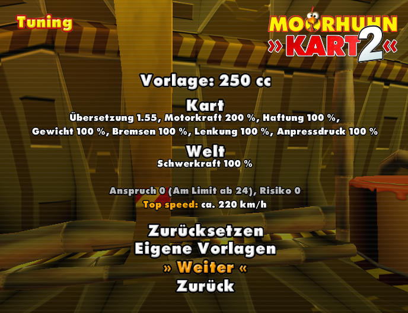
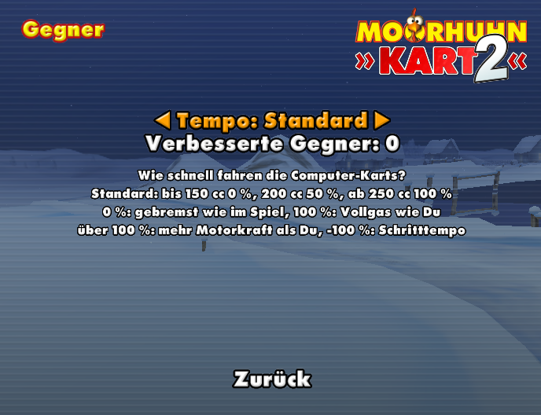

# Moorhuhn Kart 2 – 200 cc, 250 cc, a tuning class, better computer karts, 60 FPS physics, own phantoms

A fan patch for **Moorhuhn Kart 2 XXL**, the German version V1.0 from March 2004. It adds:

- **200 cc and 250 cc**: two faster classes after 50, 100 and 150 cc.
- **Tuning**: a sixth class. You set the kart and the gravity yourself in the game.
- **Gegner** (opponents): a page that sets the pace of the computer karts in every class. It
  also gives them a better way to drive.
- **60-FPS-Fahrphysik**: a switch for high frame rates. The kart drives at 200 FPS as it does at
  60 FPS.
- **Alles freigeschaltet**: a switch that opens every class, championship and track.
- **Own phantoms**: the game races you against your own best time trial. You need no helper
  program.

> **Kurz auf Deutsch:** Ein Fan-Patch für Moorhuhn Kart 2 XXL. Er bringt zwei neue
> Leistungsklassen (200 cc, 250 cc) und eine Tuning-Klasse mit eigenen Fahrwerten und Vorlagen.
> Die Seite *Gegner* stellt Tempo und bessere Computer-Karts in jeder Klasse ein. Dazu kommen
> die Schalter *60-FPS-Fahrphysik* und *Alles freigeschaltet* und eigene Phantom-Karts ohne
> Zusatzprogramm.
> Installation: das ZIP `…-de.zip` aus den [Releases](../../releases) in den Spielordner
> entpacken. Vorher `MHK2-XXL.exe` sichern. Alle Klassen öffnet der Schalter
> *Einstellungen → Alles freigeschaltet*. Der Patch ist für die deutsche V1.0 von der
> *10 Jahre Moorhuhn*-CD. Andere exe-Versionen: siehe
> [Other versions of the exe](docs/building.md#other-versions-of-the-exe).
> Die Beschreibung unten ist auf Englisch. Die Menüs im Spiel sind deutsch.

## Install

You need an installed **Moorhuhn Kart 2 XXL**. The patch does not contain the game's data.

1. Make a copy of `MHK2-XXL.exe` in your game folder. You need it to go back to the original
   game.
2. Download a zip from the [Releases](../../releases) page.
3. Unpack the zip into the game folder (the folder with `MHK2-XXL.exe`). Replace the files that
   are there.
4. Start the game. The main menu shows the patch version below its buttons.

| File | What it is |
| --- | --- |
| `MHK2-XXL.exe` | The patched game |
| `data\MK2\text-20.csv` | The new menu texts. Without this file, the new menu items show `**TEXT*NOT*FOUND***`. |
| `tools\patch_200cc.py` | The patcher, for the [commands](#commands-unlock-the-classes-build-the-exe) below. It needs Python 3. |

There are two zips with the same game file:

- `…-de.zip` has the new menu texts in German.
- `…-en.zip` has the new menu texts in English. The game's own menus stay German
  (*Weiter* = next, *Zurück* = back).

The screenshots in these documents show the German texts.

**Version numbers.** A release has two numbers, for example 1.10. A test build between two
releases has the number of the next release and `-pre`, for example 1.10-pre8.

**Update from an earlier version of the patch.** Unpack the new zip in the same way. Your save
file `settings.dat` keeps your records, phantoms, tuning values and own presets. More about
old saves: [Changelog](CHANGELOG.md).

## Commands: unlock the classes, build the exe

You do not need these commands to play. The switch *Alles freigeschaltet* in the options menu
opens everything without a command (see [Unlocking](docs/engine-classes.md#unlocking-every-class)).

The commands need [Python 3](https://www.python.org/downloads/). Run them in the game folder.
Close the game first, because the game writes `settings.dat` while it runs.

Open 50 cc to 250 cc, each with Meisterschaft 2 and tracks 5 to 8:

```powershell
py tools\patch_200cc.py --unlock settings.dat
```

Do the same and also open the tuning class:

```powershell
py tools\patch_200cc.py --unlock-tuning settings.dat
```

Lock 200 cc, 250 cc and the tuning class again. Your records, phantoms and tuning values stay:

```powershell
py tools\patch_200cc.py --lock settings.dat
```

Switch the 60 FPS physics on (or `off`):

```powershell
py tools\patch_200cc.py --physics60 on settings.dat
```

Set the name for new phantom files (12 characters at most):

```powershell
py tools\patch_200cc.py --player-name "Name" settings.dat
```

Build the patched exe yourself from your original exe, for example from your copy:

```powershell
py tools\patch_200cc.py "<original MHK2-XXL.exe>" out
```

This writes `out\MHK2-XXL.exe` and `out\data\MK2\text-20.csv`. Copy both into the game folder.
More: [Building it yourself](docs/building.md#building-it-yourself).

## What the patch does

**200 cc and 250 cc.** Two classes after 150 cc. 200 cc is as fast as 150 cc with the siren.
250 cc is as fast as 150 cc with the power can. Win Meisterschaft 2 in the class before to
unlock the next class. → [200 cc, 250 cc and unlocking](docs/engine-classes.md)


**Tuning class.** A sixth class. You set gearing, engine power, grip, weight, brakes, steering,
downforce and gravity. There are 19 ready presets and 8 slots for your own. A line tells you
if your values are extreme but still race well. → [Tuning class](docs/tuning-class.md)



**Gegner (opponents).** *Meisterschaft wählen → Gegner* sets the computer karts of every class.
*Tempo* sets how fast they drive. *Verbesserte Gegner* sets how many of them drive a racing
line that a player drove. → [Gegner](docs/opponents.md)



**60 FPS physics switch.** *Einstellungen → 60-FPS-Fahrphysik*. At high frame rates, the original
game makes the kart slow and slippery. With the switch on, the kart drives at every frame rate
as it does at 60 FPS. → [60 FPS physics switch](docs/60fps-physics.md)

**Phantom karts.** The game races you against your own best time trial. When you beat it, your
new run becomes the phantom. → [Phantom karts](docs/phantom-karts.md)

**Smaller things.** The race shows your speed in km/h. The name page remembers the last name
that you typed. → [Good to know](docs/good-to-know.md)

## Documentation

**For players**

| Document | Content |
| --- | --- |
| [200 cc, 250 cc and unlocking](docs/engine-classes.md) | How to unlock every class, the switch *Alles freigeschaltet*, what 200 cc and 250 cc change |
| [Tuning class](docs/tuning-class.md) | The tuning pages, every value, the presets, your own presets, the lines *Am Limit* and *Top speed* |
| [Gegner](docs/opponents.md) | The computer karts in every class: *Tempo*, *Verbesserte Gegner*, karts that are stuck |
| [60 FPS physics switch](docs/60fps-physics.md) | Why the game drives differently at 200 FPS, and what the switch changes |
| [Phantom karts](docs/phantom-karts.md) | Your best run as the phantom, the name in phantom files |
| [Good to know](docs/good-to-know.md) | Speed display, limits, things not tested, mhk2_manager, where to report problems |
| [Changelog](CHANGELOG.md) | What changed in each version |

**For developers**

| Document | Content |
| --- | --- |
| [Building it yourself](docs/building.md) | Other versions of the exe, the patcher, the release zips |
| [How it works](docs/how-it-works.md) | What the patch changes in the exe, and where it keeps its data in `settings.dat` |

## How this was made

The patch was made with **Claude**, Anthropic's AI model, working in Claude Code; Marki13 chose
the features, made the decisions and played the results. There is no source code of the game;
everything comes from the exe:

- Claude disassembled the original exe, traced the code it needed (classes, kart physics,
  menus, save file, phantom files) and wrote down what it found.
- Claude wrote the patcher, including the new x86 machine code it adds to the exe. Each new
  instruction was compared with a disassembler's reading of the built exe before it was used.
- Claude tested every version in a separate copy of the game, run in a window with simulated
  input, and took the measurements and screenshots in this README.

So the exe in the releases was edited by an AI, not by hand. It was tested, but report anything
odd.

## Related projects

- [mhk2_manager](https://github.com/Markimk13/mhk2_manager) – by Marki13, the author of this
  patch: a Java program that keeps your highscores of time trials, championships and duels and
  lets you pick the phantoms you race against, including imported ones from friends. From V1.1
  on it knows 200 ccm, 250 ccm and Tuning (see [Good to know](docs/good-to-know.md)).

Other Moorhuhn Kart projects by **SKevo**. This patch uses no code or data from them; they are
worth a look if you like this one:

- [idlemod](https://github.com/SKevo18/idlemod) – a command-line tool that unpacks, patches and
  repacks the data files of Moorhuhn Kart 1–4 and related games, with ready-made mods. Its
  `cheat_engine` folder has Cheat Engine tables (and a standalone trainer for Moorhuhn Kart 2)
  that change the running game: endless items, no falling off the track, respawn tweaks and more.
- [Moorhuhn Kart: Open Source](https://github.com/mhk-os/mhk-os) – a remake of the game with
  mod support; Moorhuhn Kart 2, 3, Extra and Thunder are converted into it as mods.

## Rights

Moorhuhn Kart 2 and everything in it belong to their rights holders. This is an unofficial fan
project, not connected to them. The release zips contain a modified copy of the game's exe and
are of no use without an installed game. If a rights holder objects, the files will be taken
down. The patcher script and the texts written for this project are under the MIT license
([LICENSE](LICENSE)).
