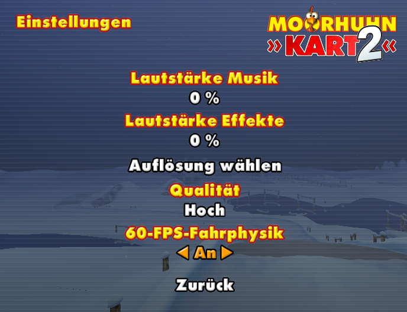
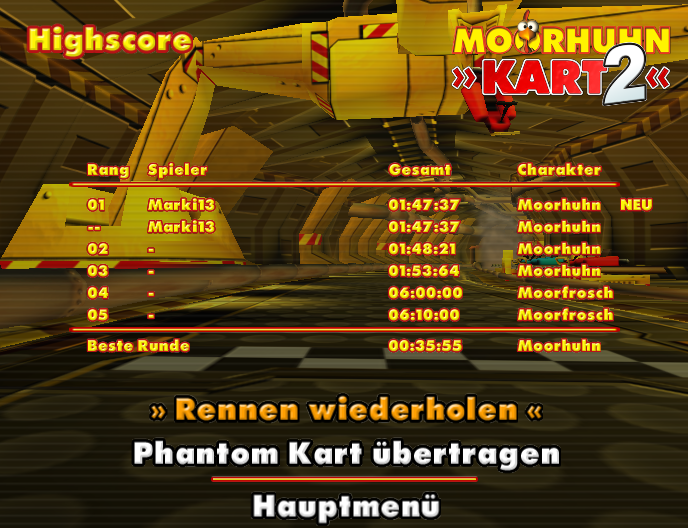
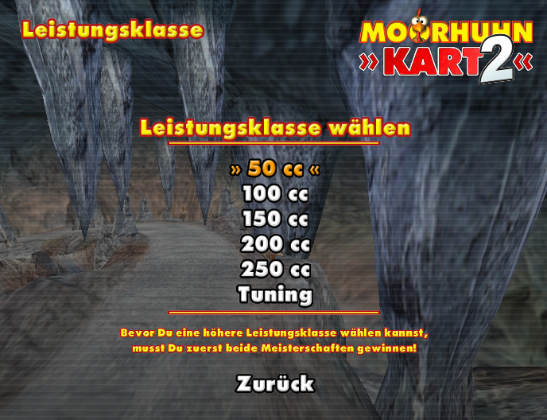
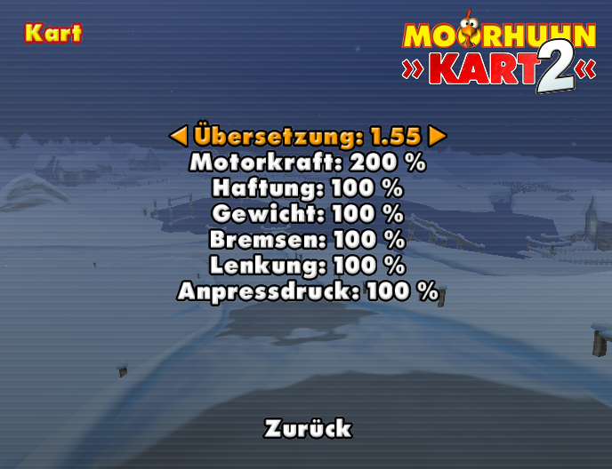
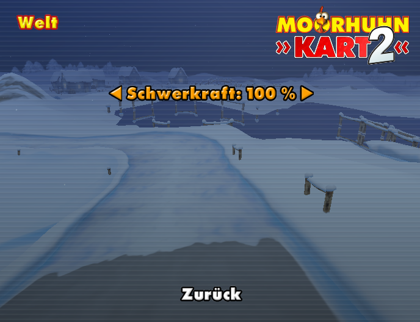
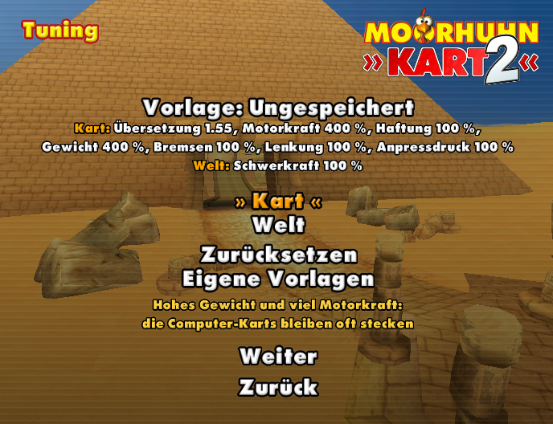
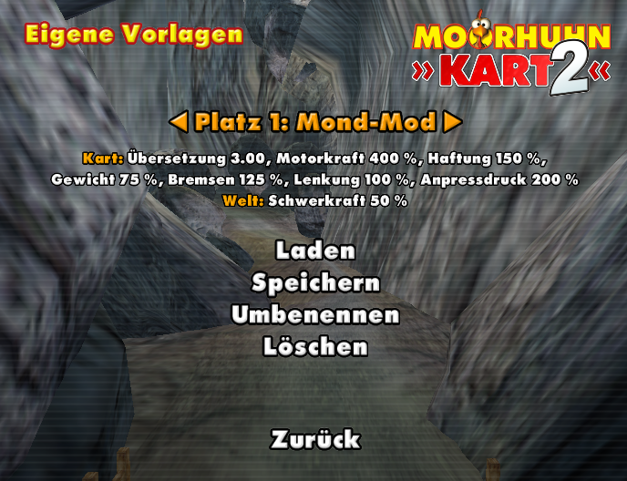

# Moorhuhn Kart 2 – 200 cc, 250 cc and a tuning class, 60 FPS physics switch, own phantom karts

A fan patch for **Moorhuhn Kart 2 XXL** (German version V1.0, exe build Mar 23 2004). It adds

- two engine classes, **200 cc** and **250 cc**, next to 50 / 100 / 150 cc,
- a sixth class, **Tuning**, whose kart and world you set up yourself in the game: gearing,
  pull, grip, weight, brakes, steering, downforce and gravity,
- a switch **60-FPS-Fahrphysik** in the options menu that makes the kart drive at any frame rate
  the way it does at 60 FPS (off by default), and
- **phantom karts without a helper program**: the game races against your own best run,
  replaces the phantom when you beat it, and labels new phantom files with data version and
  player name.

> **Kurz auf Deutsch:** Ein Fan-Patch für Moorhuhn Kart 2 XXL: zwei neue Leistungsklassen
> (200 cc, 250 cc), eine Tuning-Klasse mit eigenen Fahrwerten und Vorlagen, ein Schalter
> *60-FPS-Fahrphysik* (das Kart fährt bei 200 FPS wie bei 60 FPS) und eigene Phantom-Karts
> ohne Zusatzprogramm. Installation: das ZIP `…-de.zip` aus den
> [Releases](../../releases) in den Spielordner entpacken (vorher `MHK2-XXL.exe` sichern).
> Die Beschreibung unten ist auf Englisch; die Menüs im Spiel sind deutsch.

## Install

You need an installed **Moorhuhn Kart 2 XXL**; the patch does not include the game's data. Take
the zip from the [Releases](../../releases) page and unpack it into the game folder (the one with
`MHK2-XXL.exe`). Keep a backup of the original exe first.

| File | Purpose |
| --- | --- |
| `MHK2-XXL.exe` | patched executable |
| `data\MK2\text-20.csv` | new menu texts (plain text, editable) |

There are two zips with the same exe: `…-de.zip` has the new menu texts in German, `…-en.zip`
in English. The English one translates only the patch's own texts; the game's own menus stay
German (*Weiter* = next, *Zurück* = back). The screenshots below show the German texts.

Both files are needed – without the text file the new menu entries read `**TEXT*NOT*FOUND***`.
When updating from an earlier version of this patch, replace both again. `settings.dat` keeps its
size, so existing saves keep working. A save from version 1.6 or older gets the gravity (100 %)
added the first time the tuning class is opened; its tuning values and own presets stay.

If you would rather not run an exe from the internet, build the same files from your own
original exe with the Python script in this repository: see
[Building it yourself](#building-it-yourself). It produces the same exe as the release.

## Contents

- [60 FPS physics switch](#60-fps-physics-switch)
- [Phantom karts](#phantom-karts)
- [200 cc and 250 cc: unlocking](#200-cc-and-250-cc-unlocking)
- [200 cc and 250 cc: what changes](#200-cc-and-250-cc-what-changes)
- [Tuning class](#tuning-class)
- [Building it yourself](#building-it-yourself)
- [How it works](#how-it-works)
- [Good to know](#good-to-know)
- [How this was made](#how-this-was-made)
- [Rights](#rights)

## 60 FPS physics switch

*Hauptmenü → Einstellungen → 60-FPS-Fahrphysik: Aus / An* (Enter, ← / → or a click on the arrows).
It is stored in `settings.dat` with the game's other settings.



**The problem.** The game only limits itself to 200 FPS and runs one physics step per frame
whenever a frame is shorter than 1/60 s. The wheel springs are derived from the length of that
step, so the shorter the step, the softer they get: at 200 FPS they are 3.3 times softer and about
6 times less damped than at 60 FPS. The kart sits lower, the downforce at speed presses the chassis
onto the road, and the chassis then carries load that should be on the tyres. That is the slower,
slippery ("like ice") driving and the random hops at high frame rates. It starts at roughly
100–120 FPS; at 200 FPS the chassis touches down from about 60 % of top speed.

**The switch.** With *An*, spring and damper are always the ones the game has at 60 FPS, whatever
the frame rate. With *Aus* the game runs its original code. At 60 FPS the switch changes nothing.

Measured in the patched game (150 cc time trial, first track, identical scripted inputs; game units):

| | 60 FPS | 200 FPS, Aus | 200 FPS, An |
| --- | --- | --- | --- |
| Ride height on the grid | 3.450 | 3.416 | 3.449 |
| Speed 2.5 s after a standing start | 37.5 | 32.8 | 37.8 |
| Load not carried by the wheels, on the straight | ≈ 0 % | 20 % | 2 % |
| Sideways acceleration in a full-lock turn | 54 | 36 | 55 |

What remains different at 200 FPS with the switch on is that the game reads the controls more
often: the speed curve is the 60 FPS curve, about 0.05 s earlier (after shifting it by that much
the two agree within 0.1 %).

The switch can also be set without starting the game:

```powershell
py tools\patch_200cc.py --physics60 on "<game folder>\settings.dat"
```

## Phantom karts

The stock game saves every finished time trial as `data\Phantom\new-phantom.mhk2` and races
against `data\Phantom\phantom-C-TT.mhk2` (C = class 1–5, TT = track 01–08). But it skips every
phantom file that was recorded on the same PC – it compares an id stored in the file with its
own – so it never shows your own run. `mhk2_manager` works around that from outside.

With the patch the game does it itself:

- **Own ghosts.** Phantom files from this PC are loaded like any other.
- **The best run becomes the phantom.** A finished time trial that is faster than the phantom
  of its track and class replaces it at the finish. The first run on a track without phantom
  file creates one (that is every 200 cc and 250 cc track at first). Slower runs change nothing.
- **Version.** New phantom files start with `V1.1` when the V1.1 data (`mhk2-01.dat`) is
  loaded and with `V1.0` otherwise. The stock game always writes `V1.0`.
- **Name.** The name typed at *Neue Highscore* is kept and written into every new phantom file,
  in bytes 8–19, where `mhk2_manager` keeps its player name. The run it was typed for gets it
  too. The highscore lists show the name instead of "PHANTOM KART".



The name can be set without waiting for a highscore (at most 12 characters):

```powershell
py tools\patch_200cc.py --player-name "Name" "<game folder>\settings.dat"
```

`MHK2-XXL.exe some-file.mhk2`, the stock game's way of installing a downloaded phantom, now
also accepts files from this PC.

Things to keep in mind:

- A replaced phantom file is gone, also an imported one or one of the original phantoms. Keep
  copies of the ones you want to race again (`mhk2_manager` keeps the originals in
  `data\Phantom\source`).
- Phantom files written by the game have no `mhk2_manager` checksum, so the manager does not
  accept them as custom phantoms. Going by its code, a manager that runs alongside keeps
  archiving the runs and puts its own stamped copy in place; that combination is untested.
- The files keep this PC's id. The unpatched game on the same PC still skips them.

## 200 cc and 250 cc: unlocking

Both follow the game's own chain: win **Meisterschaft 2 in 150 cc** to open 200 cc, and
**Meisterschaft 2 in 200 cc** to open 250 cc. The win has to happen with a patched exe that
knows the class above: the stock game never recorded a win in 150 cc, and versions up to 1.2
never recorded one in 200 cc. Inside each new class, Meisterschaft 2 and tracks 5–8 open up
after winning Meisterschaft 1, as in the other classes.

To make 200 cc and 250 cc selectable straight away:

```powershell
py tools\patch_200cc.py --unlock "<game folder>\settings.dat"
```

## 200 cc and 250 cc: what changes



- **Menu:** *Leistungsklasse wählen* has six rows now: 200 cc and 250 cc, each greyed out
  while locked, and Tuning. The rows sit closer together than in the stock game to make room.
- **Speed:** the three stock classes differ in one number, the class factor (0.9 / 1.1 / 1.3).
  It lengthens the gearing; the push at the wheels is the same in all three at the same
  engine speed. So 50, 100 and 150 cc leave the line equally fast and only part once each
  reaches its gear changes.

  200 cc and 250 cc continue the gearing with **1.468** and **1.545**, and they also **pull
  harder**: 1.5 and 2 times the thrust (the siren pulls 2.5 times, the power can 5 times).
  Gearing and pull together give the top speed that a 150 cc kart has with the two speed
  power-ups: 200 cc is as fast as 150 cc with the siren, 250 cc as fast as 150 cc with the
  power can. Rebuild with `--factor`, `--pull`, `--factor-250` and `--pull-250` to change them.

  Measured with Moorhuhn on a flat straight at 60 FPS, in game units per second:

  | | Top speed | After 1 s | After 2 s | Time to 40 |
  | --- | --- | --- | --- | --- |
  | 50 cc | 36.2 (calculated) | 18.6 | 27.9 | – |
  | 100 cc | 43.5 (calculated) | 20.1 | 30.8 | – |
  | 150 cc | 50.5 | 21.2 | 32.9 | 2.91 s |
  | 150 cc with siren | 57.59 | | | |
  | **200 cc** | 57.58 | 30.0 | 44.2 | 1.65 s |
  | 150 cc with power can | 61.25 | | | |
  | **250 cc** | 61.21 | 31.8 | 49.7 | 1.37 s |

  The speeds after 1 and 2 seconds are from a standing start. No start straight in the game
  is long enough to reach top speed that way; the top speeds were measured on the longest
  flat one (fourth track) by pushing the kart with a power-up and watching where it settles
  afterwards.
- **Power-ups** multiply on top of the class: the siren in 250 cc pulls 2 × 2.5 = 5 times as
  hard as a plain 150 cc kart, and it lengthens the gearing by 10 % as in every class.
- **Lifting the throttle** brakes harder in the new classes: the pull also scales the
  engine's braking, the same way the game's power-ups do it. In the half second after
  lifting at the same engine speed (about 4450 rpm) a 150 cc kart slows down by 6.4 units/s
  per second, a 250 cc kart by 10.5.
- **Off the line** 250 cc gains nothing over 200 cc: twice the thrust is more than the tyres
  hold on the first metres. After half a second it is at 16.9 against 18.0, after one second
  it is ahead.
- **Opponents:** computer karts get the same gearing and pull and drive with each track's
  150 cc AI settings.
- **Records:** time trial and championship highscores, phantom karts, the highscore browser
  and the unlock messages work for both classes.
- **Sound:** both reuse the 150 cc engine sample.

Earlier versions of this patch had other values: up to 1.2, 200 cc had the factor 1.5; in 1.3
the factors were 1.52 and 1.64; neither had extra pull. Times and phantoms driven with them
stay in the lists. They come from karts with the same or a slightly lower top speed and a
much weaker pull, so they are easier to beat now.

## Tuning class


*Leistungsklasse wählen → Tuning* opens a page of its own before the character menu. The
class is always open, with all eight tracks and both championships. The page has the row
*Vorlage*, below it all values that are set, grouped *Kart* and *Welt* as on the page of own
presets, and buttons: *Kart* and *Welt* open the pages with the values, *Zurücksetzen* puts
the defaults back, *Eigene Vorlagen* opens your own presets, *Weiter* goes on.

- **Kart**: the seven kart values (gearing, pull, grip, weight, brakes, steering, downforce).
- **Welt**: the gravity. More rows that are not about the kart (computer karts, …) would go here.

 

Each row is changed with ← / → or a click on its arrows; *Zurück* or Esc returns to the
tuning page.

**Warnings.** Some combinations do not break anything but leave the computer karts stuck for
long stretches of a race. While the values make such a combination, a yellow line on all three
pages says which one:

| Warning | When | Computer karts stuck (six karts, 45 s, added up) |
| --- | --- | --- |
| *Hohes Gewicht und viel Motorkraft* | Gewicht 400 % and Motorkraft 400 % or more | 17 – 31 s |
| *Kein Anpressdruck bei langer Übersetzung* | Anpressdruck 0 % and Übersetzung 3.00 or more | 24 – 26 s |
| *Volle Übersetzung und Motorkraft bei wenig Anpressdruck* | Übersetzung 4.00, Motorkraft 1000 % and Anpressdruck 100 % or less | 8 – 28 s (*Dragster*: 14 – 27 s) |



With the defaults they stand still for 4 – 6 s in such a race. The warning is only a hint;
the values can be raced anyway. *Dragster* is the only built-in preset that gets one.

The row *Vorlage* copies a ready-made set of values into all eight rows: ← / → (or its
arrows) steps through the presets below, and from there each row can be changed further. The
row shows the name of the preset the values match (the one copied last, if two match), or
*Ungespeichert* once they match none; then ← / → continue from the preset copied last.

| Preset | Übers. | Motor | Haft. | Gew. | Brems. | Lenk. | Anpr. | Schwer. | Idea |
| --- | --- | --- | --- | --- | --- | --- | --- | --- | --- |
| 50 cc | 0.90 | 100 | 100 | 100 | 100 | 100 | 100 | 100 | the class |
| 100 cc | 1.10 | 100 | 100 | 100 | 100 | 100 | 100 | 100 | the class |
| 150 cc | 1.30 | 100 | 100 | 100 | 100 | 100 | 100 | 100 | the class |
| 200 cc | 1.47 | 150 | 100 | 100 | 100 | 100 | 100 | 100 | the class (its gearing is 1.468) |
| 250 cc | 1.55 | 200 | 100 | 100 | 100 | 100 | 100 | 100 | the class (1.545); the defaults |
| Rakete | 2.50 | 500 | 200 | 100 | 200 | 100 | 100 | 100 | much faster, grip and brakes to match |
| Formel 1 | 2.00 | 600 | 300 | 100 | 300 | 100 | 300 | 100 | grip, downforce and brakes for the corners |
| Rallye | 1.55 | 300 | 75 | 100 | 100 | 150 | 50 | 100 | strong engine on little grip, quick steering |
| Glatteis | 1.55 | 200 | 50 | 100 | 100 | 100 | 50 | 100 | everything slides |
| Schwergewicht | 1.55 | 200 | 100 | 300 | 200 | 100 | 100 | 100 | three times the weight |
| Federgewicht | 1.55 | 100 | 100 | 50 | 100 | 100 | 100 | 100 | half the weight, half the engine |
| Dragster | 4.00 | 1000 | 200 | 150 | 100 | 50 | 50 | 100 | straight-line monster with half the steering |
| Schnecke | 0.50 | 100 | 100 | 100 | 100 | 100 | 100 | 100 | top speed 20, for learning a track |
| Wahnsinn | 4.00 | 1000 | 400 | 50 | 400 | 200 | 800 | 100 | everything at the limit that still works |
| Mondfahrt | 1.55 | 200 | 100 | 100 | 100 | 100 | 100 | 25 | 250 cc on a quarter of the gravity: long jumps |
| Jupiter | 1.55 | 200 | 100 | 100 | 100 | 100 | 100 | 250 | 250 cc on Jupiter (2.5 times the gravity) |

The class copies drive like the classes, up to the third decimal of the gearing (the copies of
200 cc and 250 cc are 0.07 and 0.18 units/s faster at the top). The other presets were tried
by the computer karts only.

**Own presets.** *Eigene Vorlagen* on the tuning page opens a page with eight slots for your
own sets of values:



- ← / → on the top row picks the slot (*Platz 1* … *Platz 8*); below it are the slot's values,
  grouped *Kart* and *Welt* like on the tuning page, or *(leer)*. All slots start empty.
- *Speichern* stores the eight values currently set (kart and gravity) in the slot (it overwrites
  whatever was there). So: copy a preset with *Vorlage*, change it, open *Eigene Vorlagen*,
  pick a slot, *Speichern*.
- *Laden* copies the slot's values onto the tuning page and goes back there.
- *Umbenennen* opens the game's name page with the slot's name. *Weiter* keeps the typed
  name (up to 15 characters, the letters, digits and `- . !` the name page allows), Esc
  leaves it as it was, and an empty name gives the slot its default name back, *Eigene N*.
- *Löschen* empties the slot, its name included. There is no confirmation.
- The filled slots also come up in the *Vorlage* row of the tuning page, after the built-in
  presets, under their names.
- The slots are kept in `settings.dat`.

| Row | What it changes | Range | Default |
| --- | --- | --- | --- |
| Übersetzung | The class factor: longer gearing, higher top speed. 150 cc has 1.30 | 0.50 – 4.00 | 1.55 |
| Motorkraft | Pull: thrust and the limit of what the tyres put on the road | 25 – 1000 % | 200 % |
| Haftung | Grip of the tyres, sideways and in the driving direction | 25 – 400 % | 100 % |
| Gewicht | Mass of the kart | 25 – 400 % | 100 % |
| Bremsen | Brake force | 25 – 400 % | 100 % |
| Lenkung | Largest steering angle | 25 – 200 % | 100 % |
| Anpressdruck | Downforce | 0 – 800 % | 100 % |
| Schwerkraft (page *Welt*) | Gravity of the whole race: karts, computer karts and loose objects. 100 % = the game's 19.62 units/s² | 25 – 300 % | 100 % |

- The defaults are the 250 cc kart, to the nearest step (its gearing is 1.545). The percent
  rows are relative to the chosen character, so the characters keep their differences
  (Moorhuhn has more grip, Hank brakes harder, …).
- The values are stored in `settings.dat` and apply to **every kart in the race**, computer
  karts included, the same way a class does.
- The class has its own highscore lists and phantom karts (`phantom-6-NN.mhk2`). They mix runs
  with any values, so they are for fun, not for comparing.

What one row does on its own, measured with Moorhuhn from a standing start on a flat straight
at 60 FPS (speed in game units per second, the other rows at their defaults):

| Setting | After 0.5 s | After 1 s | After 2 s | |
| --- | --- | --- | --- | --- |
| Defaults | 16.9 | 31.9 | 49.8 | like 250 cc |
| Übersetzung 0.50 | 15.4 | 19.7 | 20.7 | top speed 20.8 |
| Übersetzung 4.00 | 17.3 | 34.8 | 63.9 | still gaining at the end of the straight |
| Motorkraft 25 % | 2.7 | 5.4 | 11.2 | |
| Motorkraft 1000 % | 22.9 | 37.4 | 62.6 | |
| Haftung 25 % | 5.6 | 11.4 | 25.7 | the wheels spin |
| Haftung 400 % | 18.2 | 25.0 | 46.3 | better off the line, then slower |
| Gewicht 25 % | 24.2 | 33.5 | 32.7 | top speed 34 |
| Gewicht 400 % | 15.2 | 17.8 | 28.5 | 47.7 after 3 s |
| Anpressdruck 0 % | 15.3 | 26.5 | 42.0 | 53.8 after 3 s, still gaining |
| Anpressdruck 800 % | 28.0 | 29.8 | 30.6 | top speed 31 |

- **Weight** changes more than the launch. Thrust, brakes and the resistance at speed are
  forces, so a light kart reacts harder to all three: quick off the line, low top speed.
- **Downforce** presses the kart onto the road with the square of its speed. That gives the
  tyres more to work with and holds the kart back at the same time. Bremsen and Lenkung do
  nothing on a straight; they were checked in the kart's values only.
- **Extreme values are allowed and can all be combined.** The computer karts raced the
  wildest ones for 45 s each on the first track, at 60 and at 200 FPS: everything at its
  maximum, with the weight at 400 %, at 50 % and at 25 %. No kart flew off. With the weight
  at 50 % they average 83 units/s, almost twice their pace with the default values (43);
  at 400 % such a kart is mostly stuck (29). Expect wheelies at the start and karts that
  bounce off walls and each other.
- **Gravity** pulls on every kart and loose object of the race. Races with the computer karts on the first track, 45 s, 60 FPS (mean speed of
  the six karts; the defaults: 43.8):

  | Schwerkraft | 25 % | 50 % | 100 % | 200 % | 250 % (*Jupiter*) | 300 % |
  | --- | --- | --- | --- | --- | --- | --- |
  | 250 cc values | 40.5 | 44.3 | 43.8 | 44.8 | 43.1 | 40.8 |
  | *Wahnsinn* values | 79.2 | | 82.9 | | | 81.5 |

  No kart flew off at any gravity, also not at 200 FPS with and without the switch. The
  pace hardly changes; how gravity feels by hand (jumps, sliding) nobody has tried yet.
- At high frame rates, switch *60-FPS-Fahrphysik* on for this class. Without it the soft
  springs of high frame rates let the chassis carry most of a strong downforce (the effect
  the switch is there for, only stronger).

**Downforce rules of this class.** The game applies the downforce along the kart's own
"down", growing with the square of the forward speed and also in the air. Far beyond the
stock classes that no longer works: the suspension starts to hammer, and a kart that tumbles
in the air accelerates itself until it is gone. So the tuning class adds three rules:

- The downforce stops growing at the value a kart with stock weight and stock downforce has
  at 120 units/s, which is 3.8 times what a 250 cc kart has at top speed.
- While no wheel touches the ground the limit is the value at 75 units/s.
- A kart that is tilted by more than 60° gets none. On its back it would be pushed into the
  sky; standing on its tail in a wheelie, which ten times the thrust makes it do, it would be
  shoved forward faster than its engine can go.

With the default values the first two do not come into play: the gearing of a 250 cc kart
ends at 65 units/s, with the power can at 74. So the default tuning kart drives like the
250 cc kart; only lying on its side or back it behaves differently.

## Building it yourself

Instead of the release zip, the patch can be applied to your own original exe with Python 3
(no other dependencies). The commands above that change `settings.dat` (`--physics60`,
`--player-name`, `--unlock`) need it as well.

```powershell
py tools\patch_200cc.py "<game folder>\MHK2-XXL.exe" out
```

This writes `out\MHK2-XXL.exe` and `out\data\MK2\text-20.csv`; add `--lang en` for the English
menu texts (the exe is the same). The script only accepts the original exe (SHA-256 starting
with `272bfad50336ec4c`; an already patched one is refused), checks every byte it replaces, and
never writes next to its input. `--listing FILE` dumps the added code and all patch sites.

`py tools\make_release.py "<game folder>\MHK2-XXL.exe"` builds both release zips into `dist\`.

## How it works

- 78 small patches in the original code plus about 5400 bytes of new code (and 500 of data) in an added section (`.mod200`).
- The save file has fixed tables for 3 classes × 64 tracks and 3 × 20 championships, of which only
  8 tracks and 4 championships are ever used. The new records are stored in unused slots
  (tracks 33–64 and championships 11–20): those of the 150 cc rows for 200 cc, of the 100 cc
  rows for 250 cc and of the 50 cc rows for the tuning class. So the file layout is unchanged,
  and a `settings.dat` from an earlier version of the patch keeps its records.
- Class names are texts 332 + class, and the unlock messages are numbered by class too. Some
  of the numbers the new classes need are taken by other stock texts (336, the hint in the
  class menu, and 584), so the patch moves the hint to 342 and gives 250 cc its own message
  number.
- Pull: the game multiplies the engine's torque and the traction limit by a factor that only
  its power-ups set. The patch multiplies both by the class's pull as well.
- Tuning class: the game applies a class at the end of loading a kart's values and then builds
  the kart's physics from them. The tuning class scales seven of those values at that point.
  The gravity: the game builds a new physics world at every race start with the gravity
  (0, −19.62, 0); in the tuning class a hook right behind that scales it.
  The pages are new menu pages (numbers 1Dh, 1Fh and 20h; the game's own end at 1Ch) with their
  own builder and input handling. The eight values live in a highscore entry the game never
  reaches (50 cc, track 63: `settings.dat` offset 0x2E48, the marker `TUNE` at 0x2E78). The
  presets are a table behind the patch's code, their names texts 250–265 in `text-20.csv`.
  The own presets are page 1Eh, their eight slots two more unused highscore entries (50 cc,
  tracks 61 and 62: `settings.dat` offset 0x2C60, 32 bytes each: eight values – the gravity,
  never 0, marks a filled slot – and the name), with the marker `OWNP` at 0x2D60. Behind them
  are the marker `WELT` (0x2D6C, "this save has eight values") and the number of the preset
  copied last (0x2D70; up to 1.6 it was where the gravity is now). Renaming uses the
  game's name page: a hook in front of the result pages' input handler takes *Weiter* and
  Esc while a slot is being renamed, the game does the typing.
- Downforce rules of the tuning class: the force function computes the downforce as
  coefficient × (velocity · forward axis)² along the chassis' up axis. One hook in front of
  it limits that speed to 120 × √(Gewicht / Anpressdruck), to 75 × √(…) while none of the four
  wheels reported ground contact in this step, and to zero while the vertical part of the up
  axis is below 0.5 (a tilt of 60°). In every other class the hook changes nothing.
- `text-20.csv` uses the game's built-in override mechanism (`text-NN.csv` is merged over `text.csv`).
- Suspension: for every wheel and physics step the game turns "wheels stiffness" *k* and "wheels
  damping" *c* into the solver's contact parameters `1 / (dt·(c + k·dt))` and `k·dt / (c + k·dt)`.
  The solver's effective spring is then `k·dt` and its damper `dt·(c + k·dt)` – both shrink with the
  step `dt`. With the switch on, the patch computes `1 / (h·(c + k·h))` and `k·dt / (c + k·h)` with a
  fixed `h` = 1/60 s, which gives the 60 FPS spring and damper for any `dt`.
- The switch lives in three unused padding bytes of the settings object (`settings.dat` offset
  0x49, the bytes `36 30 46` = on). The stock game saves and loads them but never looks at them.
- Phantom karts: three small patches remove the "is this file from my own PC" check (race start,
  race restart, import). At the finish the header of the new phantom is cleaned first – the
  stock game leaves bytes 5–31 of the phantom it loaded in there – and after the file is
  closed it is copied over the track's phantom file if its time is lower. The data version is
  found at startup from the size of `data\mk2\level01\objects\collision_border.dff` (29 772
  bytes in V1.1), looked up the way the game does, newest `mhk2-NN.dat` first.
- The player name is stored in a highscore entry the game never reaches (50 cc, track 64,
  rank 5: `settings.dat` offset 0x2F0C, with the marker `NAME` at 0x2F2C).

## Good to know

- **Phantoms of the new classes** are `data\Phantom\phantom-4-NN.mhk2` (200 cc),
  `phantom-5-NN.mhk2` (250 cc) and `phantom-6-NN.mhk2` (tuning), NN = track 01–08. The first
  finished time trial on a track creates the file; until then the highscore list shows a
  placeholder phantom (10:39:99).
- **mhk2_manager V1.0** only knows three engine classes; it has not been tried with phantoms
  or championship results of the new classes.
- The player name only changes when the game asks for one (a time trial result in the top
  five) or with `--player-name`. Names longer than 12 characters are cut in phantom files.
- The options menu rows sit a little higher than in the stock game to make room for the switch.
- The new texts are German, like the rest of this version's texts. `--lang en` writes them in
  English instead; the game's own texts (*Weiter*, *Zurück*, the menu titles, …) stay German.
- The switch only corrects the suspension. Two smaller frame-rate effects stay as they are: the
  computer karts' steering logic runs every other frame, and a wheel in the air loses 0.5 % of its
  spin per physics step.
- Not tried: two-player modes in the new classes or with the switch on, a race by hand in
  the new classes or with tuning values (the computer karts raced them, see above), and
  driving on the V1.1 data (with `mhk2-01.dat` only the version label of new phantom files
  was checked).
- All checks ran in sandbox copies, in a window, with simulated input and forced finishes, not
  by hand in fullscreen. Reports from real races are welcome.

## How this was made

The patch was made with **Claude**, Anthropic's AI model, working in Claude Code; Marki13 chose
the features, made the decisions and played the results. There is no source code of the game;
everything comes from the exe:

- Claude disassembled the original exe, traced the code it needed (classes, kart physics,
  menus, save file, phantom files) and wrote down what it found.
- Claude wrote the patcher, including the new x86 machine code it adds to the exe. Each new
  instruction was compared with a disassembler's reading of the built exe before it was used.
- Claude tested every version in a separate copy of the game, run in a window with simulated
  input, and took the measurements and screenshots in this README.

So the exe in the releases was edited by an AI, not by hand. It was tested, but report anything
odd.

## Rights

Moorhuhn Kart 2 and everything in it belong to their rights holders. This is an unofficial fan
project, not connected to them. The release zips contain a modified copy of the game's exe and
are of no use without an installed game. If a rights holder objects, the files will be taken
down. The patcher script and the texts written for this project are under the MIT license
([LICENSE](LICENSE)).
