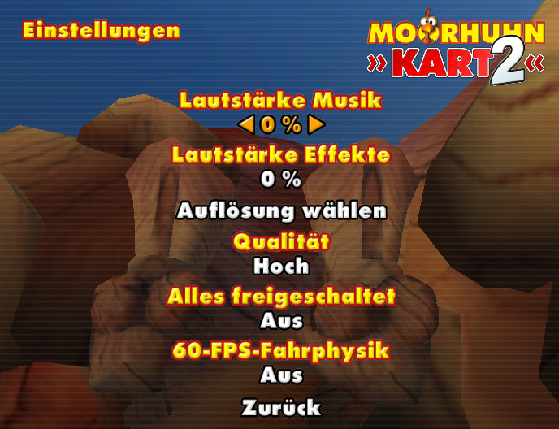

[← Overview](../README.md) · [All documents](README.md)

# 60 FPS physics switch

*Hauptmenü → Einstellungen → 60-FPS-Fahrphysik: Aus / An* (Enter, ← / → or a click on the arrows).
It is stored in `settings.dat` with the game's other settings.



**The problem.** The game only limits itself to 200 FPS and runs one physics step per frame
whenever a frame is shorter than 1/60 s. The wheel springs are derived from the length of that
step, so the shorter the step, the softer they get: at 200 FPS they are 3.3 times softer and about
6 times less damped than at 60 FPS. The kart sits lower, the downforce at speed presses the chassis
onto the road, and the chassis then carries load that should be on the tyres. That is the slower,
slippery ("like ice") driving and the random hops at high frame rates. It starts at roughly
100–120 FPS; at 200 FPS the chassis touches down from about 60 % of top speed.

**The switch.** With *An*, spring and damper are always the ones the game has at 60 FPS, whatever
the frame rate. With *Aus* the game runs its original code. At 60 FPS the switch changes nothing.

Measured in the patched game (150 cc time trial, first track, identical scripted inputs; game units):

| | 60 FPS | 200 FPS, Aus | 200 FPS, An |
| --- | --- | --- | --- |
| Ride height on the grid | 3.450 | 3.416 | 3.449 |
| Speed 2.5 s after a standing start | 37.5 | 32.8 | 37.8 |
| Load not carried by the wheels, on the straight | ≈ 0 % | 20 % | 2 % |
| Sideways acceleration in a full-lock turn | 54 | 36 | 55 |

What remains different at 200 FPS with the switch on is that the game reads the controls more
often: the speed curve is the 60 FPS curve, about 0.05 s earlier (after shifting it by that much
the two agree within 0.1 %).

**Power-ups of the computer karts** (always on, not part of the switch): the stock game lets a
computer kart fire the power-up it holds with a chance of 1 in 800 per frame. At 60 FPS that is
after 13 s on average, at 200 FPS after 4 s, so at 200 FPS they fired nearly twice as many
(21 – 23 per minute instead of 12 on the first track) and hit each other far more often: karts
stood frozen after hits and were reset onto the track. The patch counts the chance per second,
so they fire as often at any frame rate as at 60 FPS (at 60 FPS nothing changes).

The switch can also be set without starting the game:

```powershell
py tools\patch_200cc.py --physics60 on "<game folder>\settings.dat"
```
