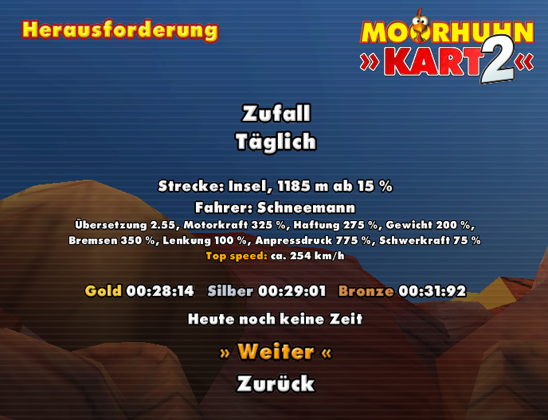
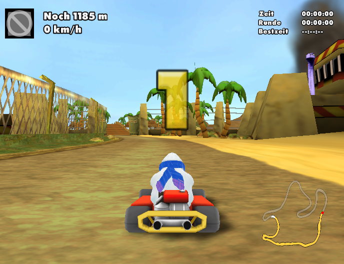

[← Overview](../README.md) · [All documents](README.md)

# Challenges

A challenge is a short time trial over one stretch of a track. The game draws the track, the
stretch, your driver and the tuning values. The daily challenge is the same for all players on
the same day, and the game keeps your best run of the day as a phantom.

## Where to find it

Open *Hauptmenü → Rennmodus → Herausforderung* (challenge). It is the third button under
*Ein Spieler* (one player). You need nothing to unlock it.

## How to use it

1. Press *Zufall* (random) for a new challenge, or *Täglich* (daily) for the challenge of the day.
2. Read the challenge on the page: the track, the length of the stretch, where it starts, your
   driver, the tuning values and the three medal times.
3. Press *Weiter* (next) to start the race.

Press *Zufall* again to draw a new challenge. *Zurück* (back) leaves the page. Your own class,
track, driver and tuning values are back when you leave.

| Button | What it does |
| --- | --- |
| *Zufall* | Draws a new random challenge. Every press gives another one. |
| *Täglich* | Draws the challenge of the day. All players get the same one on the same day. It changes at midnight UTC (1:00 in Germany in winter, 2:00 in summer). |
| *Weiter* | Starts the race. It works after a press of *Zufall* or *Täglich*. |
| *Zurück* | Goes back to the page *Rennmodus*. |

## The race

- **The stretch.** You start somewhere on the track, not on the start line. The stretch is
  1000 to 1600 m long, which is 30 % to 70 % of the track. At 200 to 250 km/h, it takes 15 to
  30 seconds.
- **Metres to go.** The top left shows *Noch 340 m* (340 m to go) instead of the lap.
- **Best time.** In a daily challenge, *Bestzeit* (best time) at the top right shows your best
  time of the day.
- **The minimap.** It shows the stretch in magenta and the finish in white. The rest of the
  track is grey.
- **The pause page.** It shows the challenge: *Tägliche Herausforderung* (daily challenge) with
  the date and your best time of the day, or *Zufällige Herausforderung* (random challenge)
  with its seed. Below are the tuning values, the top speed, the track, the stretch, your
  driver and the medal times.
- **The kart.** A challenge always uses the tuning class, with values that are hard but drivable.
  The tuning page would call them *Am Limit* or *Hart am Limit*
  ([Tuning class](tuning-class.md)). The switch *60-FPS-Fahrphysik* is on for the race.
- **The power can.** Every challenge race gives you one power can when the race starts. Fire it
  with the power-up key, at the place where it gains the most time. *Rennen wiederholen* gives
  you a new one. The phantom of the day shows where your best run fired it.
- **The finish.** The race ends after the stretch. The result page shows *Deine Zeit* (your
  time) and the medal that you won. In a daily challenge, the line below shows your best time of
  the day, or *Neue Bestzeit!* (new best time) in green. *Weiter* leads to the same lines with the buttons
  *Rennen wiederholen* (repeat the race) and *Hauptmenü* (main menu). No highscore list follows.
  *Rennen wiederholen* (repeat the race) starts the same stretch again.

## Medals

Every challenge has three times: *Gold*, *Silber* (silver) and *Bronze*. The challenge page and
the pause page show them. The result page shows the medal that your time won:

| Your time | The result page shows |
| --- | --- |
| Gold time or faster | *Goldmedaille!* (gold medal) |
| Silver time or faster | *Silbermedaille!* (silver medal) |
| Bronze time or faster | *Bronzemedaille!* (bronze medal) |
| Slower than bronze | *Keine Medaille* (no medal) and the bronze time |

The times come from races of computer karts with the same track, tuning values and driver. The
silver time is about as fast as the faster computer karts. Gold is 3 % faster, bronze is 10 %
slower.

## Records and phantoms

- **Täglich.** The page shows your best time of the day. Your best run of the day becomes the
  phantom, and the next race of the day shows it with the driver of the day. The phantom file is
  `data\Phantom\daily-<day>.mhk2`. A new day starts without a time and without a phantom.
- **Zufall.** The game keeps no time and no phantom.
- **Normal records.** A challenge never changes your records, your highscore lists or the
  phantoms of your time trials.

## Good to know

- The phantom files of earlier days stay in `data\Phantom`. You can delete them.
- **Medal times.** The times come from computer karts, not from players. On some stretches, a
  medal is easier to win than on others. Please report a time that looks wrong in the issues.
- A challenge is not part of the highscore lists of the game. Rankings with other players and
  challenges between friends are planned in the issues.

## Details

This section is for players who want the numbers.

The patch measured the computer karts with the better driver of *Verbesserte Gegner* on every
track, about 160 races in all. From these races, it knows:

- a lap time for each track,
- a factor for each of the 64 sets of tuning values: the fastest set needs about 0.67 times the
  average time, the slowest about 2.2 times,
- how the lap time spreads over the track, in 64 parts,
- the time that the standing start costs with each set (0 to 3 seconds),
- a factor for each driver (within 2 %).

The silver time is the sum of these for the drawn stretch. A test left out one race at a time
and computed it from the others. For a full lap, the model was off by 3.5 % in the middle. For a
stretch, it was off by 4.5 % in the middle, and one stretch in ten was off by 16 % or more.

How the patch does it: [How it works](how-it-works.md#challenges).
