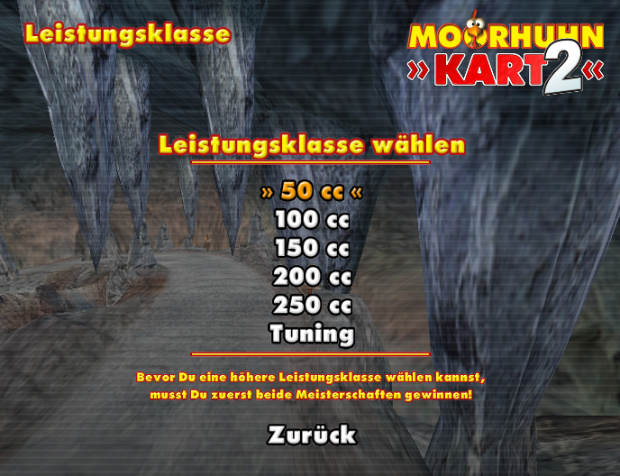
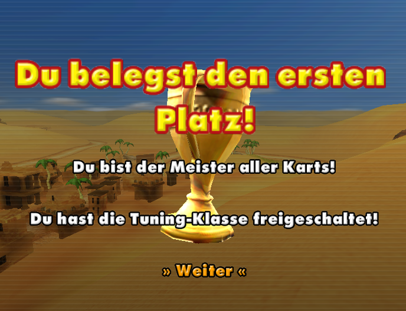
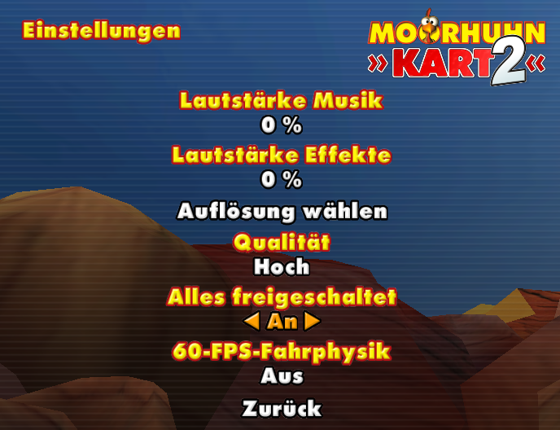

[← Overview](../README.md) · [All documents](README.md)

# 200 cc, 250 cc and unlocking

The patch adds two classes after 150 cc: 200 cc and 250 cc. They are faster and pull harder
out of corners. A third new class, *Tuning*, has [its own page](tuning-class.md).

## Where to find it

The menu *Leistungsklasse wählen* (choose class) has six rows:

- 50 cc, 100 cc and 150 cc, as in the original game.
- 200 cc and 250 cc. They are grey while they are locked.
- Tuning. This row is empty while the class is locked.

## Unlocking every class

Each class opens when you win Meisterschaft 2 (championship 2) in the class before it:

1. Win Meisterschaft 2 in 150 cc. This opens 200 cc.
2. Win Meisterschaft 2 in 200 cc. This opens 250 cc.
3. Win Meisterschaft 2 in 250 cc. This opens the tuning class. The game shows
   *Du hast die Tuning-Klasse freigeschaltet!* (you unlocked the tuning class).

In 200 cc and 250 cc, Meisterschaft 2 and tracks 5 to 8 open when you win Meisterschaft 1. This
is the same as in the other classes. The tuning class has all 8 tracks and both championships
from the start.

### Alles freigeschaltet

*Alles freigeschaltet* (everything unlocked) is a switch in the options menu. It opens
everything at once:

1. Open *Hauptmenü → Einstellungen* (settings).
2. Select *Alles freigeschaltet*. The English texts call it *Everything unlocked*.
3. Press ← or →, or click an arrow, to set it to *An* (on).

While the switch is on:

- The class menu shows all six classes, also Tuning.
- Every class has Meisterschaft 2 and tracks 5 to 8.
- The championship page has the button *Gegner* (see [Gegner](opponents.md)).

The switch does not change your progress. Set it to *Aus* (off), and the classes and tracks that
you did not win are locked again. A championship that you win while the switch is on counts as
usual. It unlocks the next class or Meisterschaft 2 for the time after you switch it off.

The commands `--unlock` and `--unlock-tuning` also open the classes. They write the progress
into `settings.dat`, so the switch cannot undo them. `--lock` locks the new classes again. See
[Commands](../README.md#commands-build-the-exe-unlock-the-classes).

## What 200 cc and 250 cc change

| | 200 cc | 250 cc |
| --- | --- | --- |
| Top speed | As fast as 150 cc with the siren | As fast as 150 cc with the power can |
| Pull | 1.5 times as much as 150 cc | 2 times as much as 150 cc |
| Computer karts | Half of the game's handicap | No handicap: full throttle, like you |

- **Power-ups** add to the class. The siren in 250 cc pulls 5 times as hard as a 150 cc kart
  without a power-up.
- **Lifting the throttle** slows the kart down faster than in 150 cc.
- **At the start**, 250 cc is not faster than 200 cc in the first half second. The tyres cannot
  use all the pull. After 1 second, 250 cc is in front.
- **Records:** time trial and championship highscores, phantoms and the unlock messages work
  in both classes.
- **Sound:** both classes use the engine sound of 150 cc.
- **Computer karts:** you can change their pace on the page [Gegner](opponents.md).

## Details

This section is for players who want the numbers.

The three original classes differ in one number, the class factor: 0.9, 1.1 and 1.3. A higher
factor gives a higher top speed. The pull at the wheels is the same in all three classes. So
50 cc, 100 cc and 150 cc start equally fast. They separate when each one reaches its gear
changes. 200 cc and 250 cc have the factors 1.468 and 1.545. They also pull 1.5 and 2 times as
hard. For comparison: the siren pulls 2.5 times as hard, the power can 5 times.

The tests used Moorhuhn on a flat straight at 60 FPS. Speeds are in game units per second.
1 unit per second is 3.6 km/h.

| | Top speed | After 1 s | After 2 s | Time to 40 |
| --- | --- | --- | --- | --- |
| 50 cc | 36.2 (calculated) | 18.6 | 27.9 | – |
| 100 cc | 43.5 (calculated) | 20.1 | 30.8 | – |
| 150 cc | 50.5 | 21.2 | 32.9 | 2.91 s |
| 150 cc with siren | 57.59 | | | |
| **200 cc** | 57.58 | 30.0 | 44.2 | 1.65 s |
| 150 cc with power can | 61.25 | | | |
| **250 cc** | 61.21 | 31.8 | 49.7 | 1.37 s |

- The speeds after 1 and 2 seconds are from a standing start.
- No start straight is long enough to reach the top speed from a standing start. So the tests
  used the longest flat straight (the fourth track). A power-up pushed the kart to a high speed.
  The top speed is the speed where the kart stayed after that.
- The siren also gives a 10 % higher top speed, in every class.
- Lifting the throttle at about 4450 rpm: a 150 cc kart loses 6.4 units/s per second, a 250 cc
  kart 10.5.
- Standing start after half a second: 250 cc 16.9, 200 cc 18.0.

Computer karts in races on the first track (75 s, mean speed of the six computer karts, units
per second): 150 cc 36.5, 200 cc 45.1, 250 cc 48.7. With version 1.8, 250 cc gave 43.2. A test
with full throttle in every situation gave 50.2 in 250 cc. This is the same within the
differences between races.

Earlier versions of the patch had other values. Up to 1.2, 200 cc had the factor 1.5. In 1.3,
the factors were 1.52 and 1.64. Both versions had no extra pull. Your times and phantoms from
these versions stay in the lists. Those karts had the same or a slightly lower top speed and much
less pull. So these times are easier to beat now.

How the patch does it: [How it works](how-it-works.md#200-cc-250-cc-and-unlocking).
