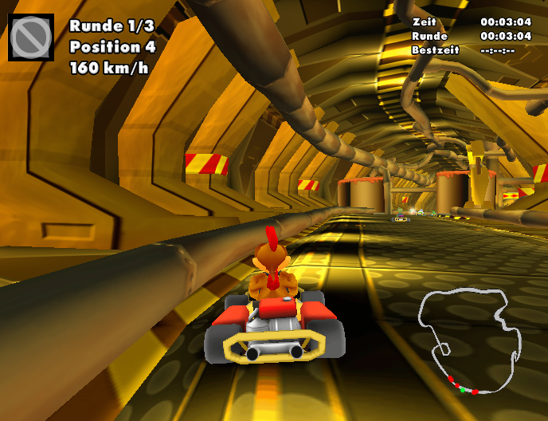

[← Overview](../README.md) · [All documents](README.md)

# Good to know

Short answers about the patch. The pages of the features have more.

## Limits

- **Speed while racing.** In every class, the race shows the speed of your kart in km/h below
  *Runde* (lap) and *Position*. In the two-player game, each player sees the speed of their own
  kart.

  
- **Laps after a jump over the start line.** The game counts a lap only when your kart drives
  through the start line. If your kart flies over it, the game counts no more laps in this race.
  Then the race cannot end. Only the tuning class with a high *Übersetzung* (gearing) and a
  power-up is fast enough for this jump. Restart the race when it happens.
- **Language.** The new menu texts are German. The English zip has them in English. The game's
  own texts (*Weiter*, *Zurück*, the menu titles) stay German in both zips.
- **Menu layout.** The rows of the options menu are higher and closer together than in the
  original game, to make room for the two switches. On the pause page, each volume is one line,
  and the items are lower. This makes room for the lines with the class and the values.

## Not tested

- Two-player games in the new classes, or with the switch *60-FPS-Fahrphysik* on.
- Races with the data of the V1.1 update (`mhk2-01.dat`). Only the version in new phantom files
  was checked.
- Improved computer karts in 100 cc and 200 cc (see [Gegner](opponents.md)).

## Other programs

- **mhk2_manager** knows 200 ccm, 250 ccm and Tuning from its version V1.1. V1.0 stops at the
  first run in a new class. V1.1 was used next to the patched game.

## Problems and reports

- **How the patch was tested.** The patch was played by hand in fullscreen, in the new classes
  and against own phantoms. The measurements come from test copies of the game in a window, with
  simulated input. Reports from your races help.
- **Open points and reports** are [GitHub issues](https://github.com/Markimk13/mhk2-experiments/issues).
