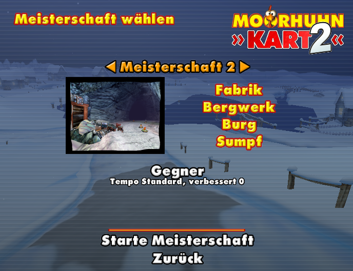
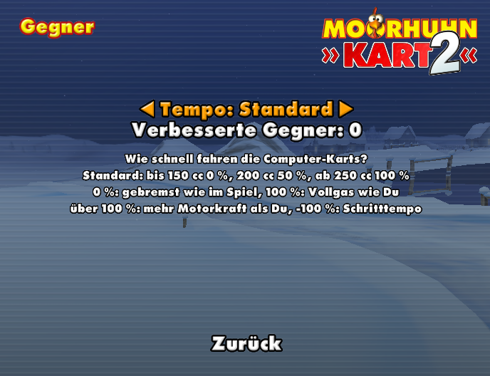

[← Overview](../README.md) · [All documents](README.md)

# Gegner: the computer karts

The page *Gegner* (opponents) sets the computer karts of your championships. *Tempo* sets how
fast they drive. *Verbesserte Gegner* (improved opponents) gives them a racing line that a
player drove. The two values hold in every class.

## Where to find it

1. Go to the page *Meisterschaft wählen* (choose championship), in any class.
2. Select the button *Gegner*. The line below the button shows the two values.
3. Change the values. *Zurück* (back) or Esc takes you back to the championship page.

The button is there after you unlock the tuning class, or while the switch *Alles
freigeschaltet* is on (see [Unlocking](engine-classes.md#unlocking-every-class)). Before that,
the championship page is the game's own page, and the two values are at their defaults.

The English texts call the page *Opponents*, and the rows *Pace* and *Improved opponents*.

## The settings

| Setting | Values | Default | What it does |
| --- | --- | --- | --- |
| *Tempo* (pace) | *Standard*, −100 % to 200 % in steps of 25 % | *Standard* | How fast the computer karts drive |
| *Verbesserte Gegner* | 0 to 6 | 0 | How many of the six computer karts use the better driver |

Press ← or →, or click an arrow, to change a value. The values hold in both championships of
every class. In a time trial, they have no effect.

### Tempo

The game holds the computer karts back. Near you, they drive with part throttle. Each kart also
has its own strength. When they are in front of you, they slow down more. *Tempo* sets how much
of this handicap stays:

| Tempo | The computer karts |
| --- | --- |
| *Standard* | Drive with the pace of the class, see the next table |
| −100 % | Drive at walking pace |
| 0 % | Have the game's full handicap, as in the original game |
| 50 % | Have half of the handicap |
| 100 % | Have no handicap. They drive with full throttle, like you. |
| 200 % | Have full throttle and two times your engine power |

*Standard* is different in each class:

| Class | *Standard* is |
| --- | --- |
| 50 cc, 100 cc, 150 cc | 0 % (the original game) |
| 200 cc | 50 % |
| 250 cc, Tuning | 100 % |

Above 100 %, the computer karts are faster out of corners. They are not faster on straights,
because the gearing limits their top speed.

### Verbesserte Gegner

The game's computer karts drive along the middle of the road. They take each corner at a speed
that suits 150 cc. In the fast classes, they slide wide and the game must put them back on the
track.

An improved kart drives differently:

- It follows the line and the speed of a player's 250 cc time trials on that track.
- It brakes when it is faster than the player was at the same place.
- It stays on the road at the player's large shortcuts.
- It brakes and steers around a slow kart in front of it.

Example: with 3, three karts use the better driver, and three use the game's driver. 0 is the
original game.

The improved karts help most in 200 cc, 250 cc and the tuning class. In 50 cc and 150 cc, they
are about as fast as the game's karts. But the game must put them back on the track less often.

## Good to know

- **Stuck karts.** In 200 cc, 250 cc and the tuning class, a computer kart that makes no progress
  for 5 seconds goes back to the middle of the road. In 50 cc, 100 cc and 150 cc, this rule
  holds only after you change one of the two values. For your own kart, only the game's rule
  holds: the game puts your kart back after about 4 seconds without movement.
- **Pause page.** In a race with computer karts, the pause page (Esc) shows the two values.
- **Tuning presets** do not change the two values. The preset *Hetzjagd* was made for *Tempo*
  200 %. Set it yourself.
- **Not tested:** improved karts in 100 cc and 200 cc, and in the tuning class with values other
  than those of 250 cc.
- **Old saves:** a save from patch 1.9 or older starts with *Standard* and 0.

## Details

This section is for players who want the numbers.

**Tempo.** Below 0 %, the karts get less throttle, down to none at −100 %. The game gives every
kart full throttle below 10 units/s, so they still move at walking pace. At 200 %, they have two
times the pull, on top of the pull of the class and of power-ups. Races on the first track
(250 cc, mean speed of the six computer karts, units per second):

| Tempo | −100 % | −50 % | 0 % | 50 % | 100 % | 150 % | 200 % |
| --- | --- | --- | --- | --- | --- | --- | --- |
| Speed | 10.2 | 38.3 | 43.6 | 46.7 | 49.0 – 49.8 | 51.1 | 51.1 |

In 150 cc, *Tempo* 100 % made the six karts 6 % faster than *Standard*.

**The tables of the improved karts.** For each track, a table holds the player's speed and place
across the road at 256 places of the lap. An improved kart brakes when it is faster than 110 %
of the player's speed. In the tuning class, this limit changes with *Übersetzung*.

- First test: 250 cc at 200 FPS with *60-FPS-Fahrphysik*, all 8 tracks, 60 seconds each. The
  improved karts drove 3 to 5 % farther than the game's karts. The game put them back on the
  track less often.
- Races of improved karts against each other then corrected the tables at 5 places on 4 tracks
  (Moorhuhn X, Ägypten, Fabrik, Sumpf). There, a kart now takes another line or a lower speed
  than the player. At 2 places (Fabrik, Sumpf), it ignores a speed limit that the game sets for
  its own karts.
- 12 races for each track, new tables against old tables: 5 % farther on Ägypten, 9 % farther
  on Sumpf. On Moorhuhn X and Fabrik, only the corrected places got faster.
- 50 cc and 150 cc: 3 improved karts against 3 of the game's, 3 tracks, 90 seconds, 18 kart
  races for each side. Distance: +0.6 % in 50 cc, +3.7 % in 150 cc. Both are inside the
  differences between races. The game put an improved kart back 0.6 times for each race in
  50 cc (game's karts: 1.0), and 0.8 times in 150 cc (game's karts: 1.2).

**A slow kart in front.** When a kart in front drives at less than half the speed, an improved
kart brakes. It arrives at most 15 units/s faster than the slow kart. Its path also moves 0.4
road widths to the side, from 20 units before the slow kart. The game's karts move only 0.15
road widths to the side, from 1.5 units before, and do not brake. Without this rule, an item
that stopped one kart also stopped the karts behind it. Test: 33 races with the rule and 33
without it (250 cc, six improved karts, all 8 tracks, 120 seconds each). Pile-ups of 3 or more
karts went from 30 to 12. Stops for each kart went from 2.7 to 2.3. The distance did not change
measurably. No test had a player in the race.

**Stuck karts.** The game's own rule puts a kart back only when it moves less than 1 unit in 1
second. A kart that pushed against an obstacle could stay there for a minute or longer. Some
tracks also have side areas with their own place to put a kart back. A computer kart did not
find the way out of these areas. On Fabrik, under the bridge, one kart drove into the same pit
every 3 seconds until the race ended. Now the patch always puts a computer kart back on the
road. Test races on Fabrik (250 cc, 120 seconds): the longest time without progress went from
82 to 21 seconds. The time that a kart stood still went from 17 to 10 seconds. On the other
tracks, the rule changes little.

How the patch does it: [How it works](how-it-works.md#gegner-the-computer-karts).
