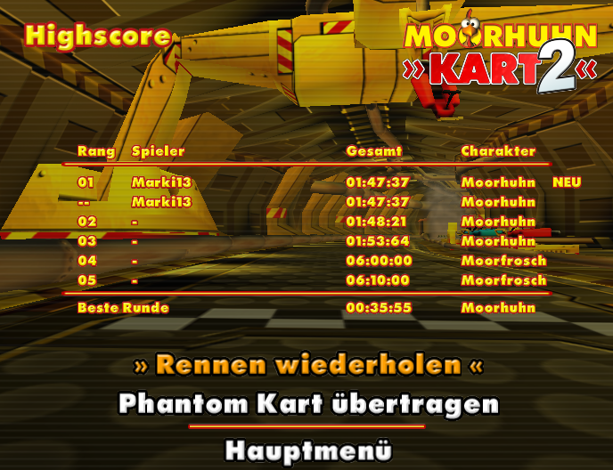

[← Overview](../README.md) · [All documents](README.md)

# Phantom karts

A phantom is a recorded run that drives with you in a time trial. The original game never shows
your own runs as phantoms. With the patch, the game races you against your own best run, and you
need no helper program.

## Where to find it

Start a time trial in any class. The phantom of the track and the class drives with you. The
game keeps the phantoms in the folder `data\Phantom`.



## How to use it

- **Your own phantoms.** The game loads phantom files from your PC like all other phantom files.
- **Your best run becomes the phantom.** When you finish a time trial faster than the phantom,
  your run replaces the phantom. A slower run changes nothing.
- **The first run** on a track without a phantom file creates the file. At first, this is every
  track in 200 cc, 250 cc and Tuning.
- **Your name.** When you get a new highscore, the game asks for your name. The game writes this
  name into every new phantom file. The highscore lists show the name instead of
  "PHANTOM KART". The next time, the name page already shows your name. Press Enter to keep it.
- **Downloaded phantoms.** Drag a phantom file onto `MHK2-XXL.exe` to install it, as in the
  original game. This now also works for files from your PC.

You can set the name without a new highscore. It can have 12 characters:

```powershell
py tools\patch_200cc.py --player-name "Name" settings.dat
```

## Good to know

- **A replaced phantom is gone**, also an imported phantom or a phantom of the original game.
  Keep copies of the phantoms that you want to race again. `mhk2_manager` keeps the original
  phantoms in `data\Phantom\source`.
- **mhk2_manager** does not accept the phantom files of the game as its own custom phantoms,
  because they have no checksum of the manager. The manager and the patched game together are
  not tested.
- **The original game** on the same PC still does not load these files.
- **The name** changes only when the game asks for it, or with `--player-name`. The game asks
  when a time trial gets into the top five.
- **File names** of the new classes: `phantom-4-NN.mhk2` (200 cc), `phantom-5-NN.mhk2`
  (250 cc) and `phantom-6-NN.mhk2` (Tuning). NN is the track, 01 to 08. Until the first run,
  the highscore list shows a placeholder phantom with 10:39:99.
- **Version.** New phantom files start with `V1.1` when the game has the data of the V1.1
  update (`mhk2-01.dat`). Otherwise they start with `V1.0`. The original game always writes
  `V1.0`.

How the patch does it: [How it works](how-it-works.md#phantom-karts).
