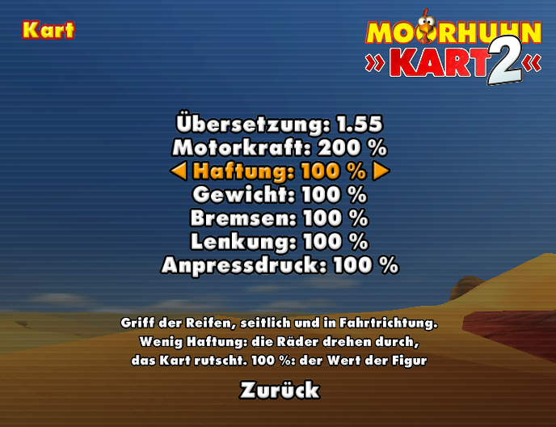
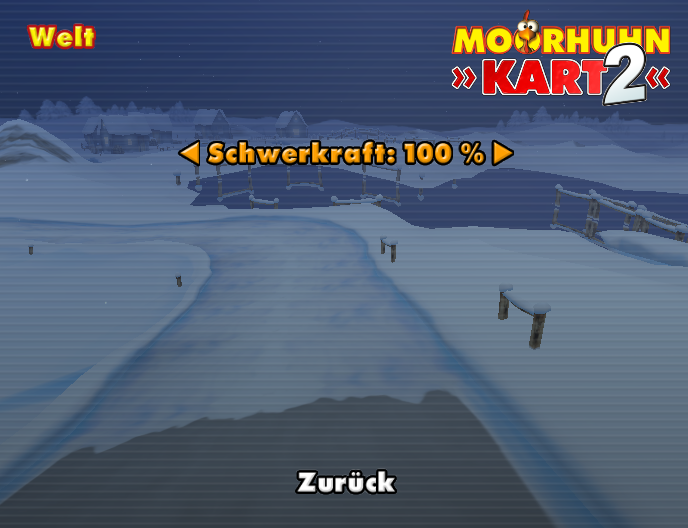
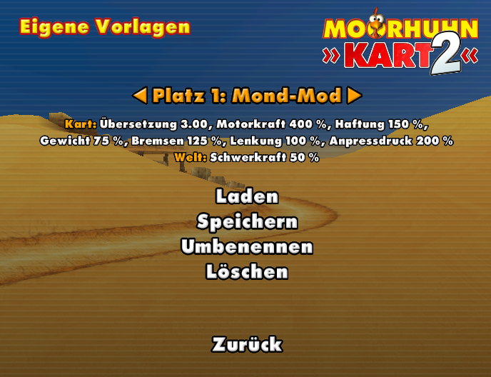
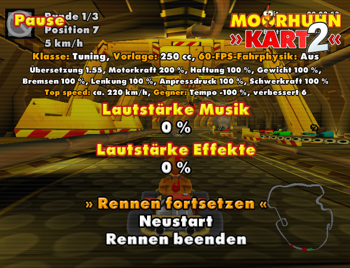

[← Overview](../README.md) · [All documents](README.md)

# Tuning class

The tuning class is a sixth class. You set the values of the kart and the gravity yourself.
Start from one of 19 presets, or save up to 8 sets of your own. A line tells you if your values
are extreme but still give a good race.

## Where to find it

*Leistungsklasse wählen → Tuning* (choose class → Tuning). Win Meisterschaft 2 in 250 cc to
unlock the class (see [Unlocking](engine-classes.md#unlocking-every-class)). The class has all 8
tracks and both championships.

The tuning page comes before the character menu:

| Item | What it does |
| --- | --- |
| *Vorlage* (preset) | Copies a preset into all values. Press ← or → to choose. |
| *Kart* | Opens the page with the seven kart values. The line below shows them. |
| *Welt* (world) | Opens the page with the gravity. The line below shows it. |
| *Zurücksetzen* (reset) | Sets all values back to the defaults |
| *Eigene Vorlagen* (own presets) | Opens the page with your 8 slots |
| *Weiter* (next) | Goes on to the character menu |

On the pages *Kart* and *Welt*:

1. Press ↑ or ↓ to select a row. A short text below the rows explains it.
2. Press ← or →, or click an arrow, to change the value.
3. Press *Zurück* (back) or Esc to go back to the tuning page.

 

The computer karts of the tuning class have their settings on the page [Gegner](opponents.md),
like in every class.

## The settings

| Setting | Values | Default | What it does |
| --- | --- | --- | --- |
| *Übersetzung* (gearing) | 0.50 to 4.00 | 1.55 | A higher value gives a higher top speed. 150 cc has 1.30. |
| *Motorkraft* (engine power) | 25 to 1000 % | 200 % | Pull of the engine, and how much of it the tyres put on the road |
| *Haftung* (grip) | 25 to 400 % | 100 % | Grip of the tyres, to the side and forward |
| *Gewicht* (weight) | 25 to 400 % | 100 % | Weight of the kart |
| *Bremsen* (brakes) | 25 to 400 % | 100 % | Force of the brakes |
| *Lenkung* (steering) | 25 to 200 % | 100 % | How far the front wheels turn |
| *Anpressdruck* (downforce) | 0 to 800 % | 100 % | Force that presses the kart onto the road at speed |
| *Schwerkraft* (gravity, page *Welt*) | 25 to 300 % | 100 % | Gravity for the whole race: all karts and all loose objects |

- The defaults are the 250 cc kart.
- The percent values change the values of your character. So the characters keep their
  differences. For example, Moorhuhn has more grip, and Hank brakes harder.
- The values hold for **every kart in the race**, also for the computer karts.

### Presets

The row *Vorlage* copies a preset into all values. After that, you can change each value.
The row shows the name of the preset that your values match. When they match no preset, it
shows *Ungespeichert* (not saved). Then ← and → continue from the preset that you copied last.

| Preset | Übers. | Motor | Haft. | Gew. | Brems. | Lenk. | Anpr. | Schwer. | Top speed (km/h) | Idea |
| --- | --- | --- | --- | --- | --- | --- | --- | --- | --- | --- |
| 50 cc | 0.90 | 100 | 100 | 100 | 100 | 100 | 100 | 100 | 130 | The class |
| 100 cc | 1.10 | 100 | 100 | 100 | 100 | 100 | 100 | 100 | 156 | The class |
| 150 cc | 1.30 | 100 | 100 | 100 | 100 | 100 | 100 | 100 | 180 | The class |
| 200 cc | 1.47 | 150 | 100 | 100 | 100 | 100 | 100 | 100 | 206 | The class |
| 250 cc | 1.55 | 200 | 100 | 100 | 100 | 100 | 100 | 100 | 220 | The class, and the defaults |
| Rakete | 3.45 | 325 | 250 | 100 | 400 | 200 | 250 | 100 | 325 | Much faster, with grip, brakes and steering to match |
| Formel 1 | 3.60 | 300 | 200 | 100 | 400 | 200 | 350 | 100 | 318 | Long gearing, much downforce, big brakes |
| Rallye | 1.80 | 325 | 50 | 75 | 100 | 125 | 100 | 100 | 196 | A strong, light kart on half the grip, with quick steering |
| Glatteis | 1.55 | 200 | 50 | 100 | 75 | 125 | 75 | 100 | 220 | Everything slides |
| Bremsversagen | 2.65 | 250 | 100 | 100 | 25 | 100 | 325 | 100 | 223 | Fast, and the brakes are almost gone. Brake early. |
| Schwergewicht | 1.55 | 250 | 100 | 250 | 250 | 100 | 200 | 100 | 222 | Two and a half times the weight |
| Federgewicht | 1.55 | 100 | 100 | 50 | 100 | 100 | 100 | 100 | 160 | Half the weight, half the engine |
| Federleicht | 2.90 | 325 | 175 | 25 | 100 | 100 | 175 | 150 | 244 | A quarter of the weight on a fast kart, more gravity to hold it down |
| Hetzjagd | 1.75 | 275 | 150 | 100 | 100 | 100 | 100 | 100 | 226 | A little faster than 250 cc, with more grip. Made for *Tempo* 200 % on the page *Gegner*. |
| Schnecke | 0.50 | 100 | 100 | 100 | 100 | 100 | 100 | 100 | 74 | Very slow, to learn a track |
| Wahnsinn | 3.15 | 350 | 50 | 25 | 25 | 100 | 275 | 300 | 277 | Everything extreme: long gearing, little grip, very light, no brakes, three times the gravity |
| Mondfahrt | 1.55 | 200 | 100 | 100 | 100 | 100 | 100 | 25 | 220 | 250 cc on a quarter of the gravity: long jumps |
| Mondrakete | 3.60 | 325 | 175 | 100 | 100 | 200 | 350 | 50 | 336 | A very fast kart on half the gravity, held down by downforce |
| Jupiter | 1.55 | 200 | 100 | 100 | 100 | 100 | 100 | 250 | 188 | 250 cc on Jupiter (2.5 times the gravity) |

The presets do not change the page *Gegner*. A copy of a class has the kart of that class. For
the computer karts of that class, set *Tempo* yourself: 0 % for 50 cc to 150 cc, 50 % for
200 cc.

### Eigene Vorlagen (own presets)

*Eigene Vorlagen* on the tuning page opens a page with 8 slots for your own values:

| Item | What it does |
| --- | --- |
| *Platz 1* … *Platz 8* (slot) | Press ← or → to choose a slot. Below it are its values, or *(leer)* (empty). |
| *Laden* (load) | Copies the values of the slot to the tuning page and goes back there |
| *Speichern* (save) | Saves your current values in the slot. It replaces what was there. |
| *Umbenennen* (rename) | Opens the name page. See the steps below. |
| *Löschen* (delete) | Empties the slot and removes its name. The game does not ask first. |

To save your own preset:

1. Copy a preset with *Vorlage*.
2. Change the values.
3. Open *Eigene Vorlagen*.
4. Choose a slot.
5. Select *Speichern*.

To rename a slot:

1. Select *Umbenennen*.
2. Type the name. It can have 15 characters: letters, digits and `- . !`.
3. Press *Weiter* to keep the name, or Esc to cancel. An empty name gives the slot its default
   name, *Eigene N*.

Your filled slots also appear in the row *Vorlage* of the tuning page, after the built-in
presets.

### The line Am Limit

Many extreme values do not give a good race. The computer karts get stuck, the game must put
them back again and again, or they drive on their tails. The line *Am Limit* (at the limit)
helps you find extreme values that still work. It is on the tuning page and on each of its
pages.

Each value gives *Anspruch* (challenge) points and *Risiko* (risk) points. The line shows both:

| The line shows | Color | Meaning |
| --- | --- | --- |
| *Am Limit: extrem, aber noch fahrbar* | Green | The race is clearly harder, and it still works as well as with the defaults |
| *Hart am Limit: gerade noch fahrbar* | Bright green | The race is clearly harder, and close to the point where races stop working |
| *Anspruch … (Am Limit ab 24)* | Grey | The values are near the defaults, or they make the race only easier or slower |
| *zu riskant (fahrbar bis 23)* | Orange | Too risky: races with these values often do not work |

The line changes with each step of a value. So you can raise a value until the line changes
from *Am Limit* to *Hart am Limit*, and then to *zu riskant*. The line judges the computer karts.
It does not judge how the kart feels for you.

### The line Top speed

Below the line *Am Limit*, each tuning page shows the top speed of your values, for example
*Top speed: ca. 220 km/h* for the defaults. The number is for the character that you chose last,
on flat ground, without power-ups. The siren and the power can go faster.

### The pause page

During a race, press Esc. The pause page shows:

- the class and the switch *60-FPS-Fahrphysik*,
- in the tuning class: the preset that your values match, all 8 values and the top speed,
- in a race with computer karts: the two values of the page *Gegner*.

## Good to know

- **Extreme values are allowed**, and you can combine all of them. Expect wheelies at the start,
  and karts that bounce off walls and off each other.
- **High frame rates:** switch *60-FPS-Fahrphysik* on for this class. Without it, much
  downforce presses the body of the kart onto the road (see
  [60 FPS physics switch](60fps-physics.md)).
- **Records:** the class has its own highscore lists and phantoms. They mix runs with all
  kinds of values. So they are for fun, not to compare times.
- **Old saves:** your values and own presets stay when you update the patch. A save from patch
  1.6 or older gets the gravity 100 % the first time that you open the class.

## Details

This section is for players who want the numbers.

**One value at a time.** The tests used Moorhuhn from a standing start on a flat straight at
60 FPS. The other values were at their defaults. Speeds are in game units per second (1 unit/s
= 3.6 km/h).

| Setting | After 0.5 s | After 1 s | After 2 s | |
| --- | --- | --- | --- | --- |
| Defaults | 16.9 | 31.9 | 49.8 | Like 250 cc |
| Übersetzung 0.50 | 15.4 | 19.7 | 20.7 | Top speed 20.8 |
| Übersetzung 4.00 | 17.3 | 34.8 | 63.9 | Still faster at the end of the straight |
| Motorkraft 25 % | 2.7 | 5.4 | 11.2 | |
| Motorkraft 1000 % | 22.9 | 37.4 | 62.6 | |
| Haftung 25 % | 5.6 | 11.4 | 25.7 | The wheels spin |
| Haftung 400 % | 18.2 | 25.0 | 46.3 | Better at the start, then slower |
| Gewicht 25 % | 24.2 | 33.5 | 32.7 | Top speed 34 |
| Gewicht 400 % | 15.2 | 17.8 | 28.5 | 47.7 after 3 s |
| Anpressdruck 0 % | 15.3 | 26.5 | 42.0 | 53.8 after 3 s, still faster |
| Anpressdruck 800 % | 28.0 | 29.8 | 30.6 | Top speed 31 |

- **Weight** changes more than the start. Thrust, brakes and the resistance at speed are forces.
  A light kart reacts more to all three. It starts quickly but has a low top speed.
- **Downforce** grows with the square of the speed. It gives the tyres more grip. It also holds
  the kart back.
- *Bremsen* and *Lenkung* have no effect on a straight. The tests checked them only in the kart's
  values.
- **Extreme values.** The computer karts raced the most extreme sets for 45 s each on the first
  track, at 60 and at 200 FPS: all values at the maximum, with the weight at 400 %, 50 % and
  25 %. No kart flew away. With the weight at 50 %, their mean speed was 83 units/s, almost two
  times the speed with the defaults (43). At 400 %, a kart was stuck most of the time (29).
- **Gravity.** Races with the computer karts on the first track, 45 s, 60 FPS, mean speed of the
  six karts:

  | Schwerkraft | 25 % | 50 % | 100 % | 200 % | 250 % (*Jupiter*) | 300 % |
  | --- | --- | --- | --- | --- | --- | --- |
  | 250 cc values | 40.5 | 44.3 | 43.8 | 44.8 | 43.1 | 40.8 |
  | *Wahnsinn* values up to 1.8 | 79.2 | | 82.9 | | | 81.5 |

  No kart flew away at any gravity, also not at 200 FPS with and without the switch. Nobody has
  tested yet how the gravity feels when you drive yourself.

**Am Limit.** The challenge points are set by hand. The risk points come from about 1250 races
of 45 s with six computer karts on all 8 tracks at 60 FPS. Each race got a badness value. It
compares three things with the defaults on the same track: how long the karts stood still, how
often the game put them back, and how long they had no wheel on the ground. Badness 0 is a race like with the
defaults. Badness 1 is a race where the karts were clearly stuck, put back or in the air.

| Line | Races | Mean badness | Clearly bad races |
| --- | --- | --- | --- |
| *Am Limit* | 215 | 0.26 | 7 % |
| *Hart am Limit* | 304 | 0.42 | 15 % |
| *zu riskant* | 367 | 1.50 | 62 % |
| The defaults | 18 | 0.01 | 0 % |

- Green: Anspruch 24 or more, Risiko below 12. Bright green: Anspruch 24 or more, Risiko 12 to
  23. Orange: Risiko 24 or more. The line shows points below 0 as 0.
- Two pairs of values also give points together: engine power and weight against downforce,
  and gearing against downforce.
- One value alone (the others at the defaults): *Übersetzung* 2.60 to 2.70 gives *Am Limit*,
  2.75 to 3.50 *Hart*. *Motorkraft* 575 % gives *Hart*. *Haftung* 50 % gives *Am Limit*, 25 %
  *Hart*. *Bremsen* 25 % gives *Am Limit*. *Lenkung* 50 % gives *Hart*. *Schwerkraft* 300 % gives
  *Am Limit*, 25 % *Hart*.
- Single races are very different from track to track. So the line tells what works on average.
- The presets were also raced at 200 FPS with *60-FPS-Fahrphysik* on. They did as well.
- Up to 1.9, *Tempo* of the computer karts also counted. Up to 1.8, the class had yellow
  warnings for three bad combinations instead of the line.

| Preset | Anspruch | Risiko | Line |
| --- | --- | --- | --- |
| Rakete | 24 | 17 | Hart am Limit |
| Formel 1 | 24 | 16 | Hart am Limit |
| Rallye | 50 | 8 | Am Limit |
| Glatteis | 41 | 10 | Am Limit |
| Bremsversagen | 55 | 4 | Am Limit |
| Schwergewicht | 12 | 23 | Grey |
| Federleicht | 56 | 10 | Am Limit |
| Hetzjagd | 8 | 2 | Grey (up to 1.9, with its *Tempo* 200 %: 39 and 21, Hart am Limit) |
| Wahnsinn | 145 | 23 | Hart am Limit |
| Mondfahrt | 32 | 15 | Hart am Limit |
| Mondrakete | 44 | 14 | Hart am Limit |
| Jupiter | 21 | 3 | Grey |

The class copies, *Federgewicht* and *Schnecke* have 0 and 0.

**Top speed.** The characters differ in weight and gearing. With the defaults: Moorhuhn and
Lesshuhn 220 km/h, Moorfrosch 203, Pumpkin 211, Snowman 218, Turtle 193, Hank 214. The formula
comes from about 420 runs on an endless straight: the kart jumped back 39 units each time it
reached the end of the start straight of *Ägypten*. The runs had values from all rows and all
seven characters. Half of the runs are within 1.8 % of the line, 9 in 10 within 7 %, every
preset within 2.5 %. The number is for 60 FPS physics (the switch on, or the game at 60 FPS).

From about 220 km/h, the downforce and the weight press the kart down harder than its wheels
can carry. Then the body of the kart rubs on the road. So *Übersetzung* alone soon stops giving
more speed. Measured: 2.00 gives 223 km/h, 3.00 gives 230 km/h. The line shows 226 for both.
More *Motorkraft*, more *Gewicht*, less *Anpressdruck* or less *Schwerkraft* move this limit
higher. *Haftung*, *Bremsen* and *Lenkung* have no effect on a straight.

**The presets.** The class copies drive like the classes, to the third decimal of the gearing.
The copies of 200 cc and 250 cc are 0.07 and 0.18 units/s faster at top speed. The computer
karts of the tuning class use the rules of 150 cc. So with *Tempo* 0 %, they only come close to
those of 50 cc and 100 cc. The other presets were tested with the computer karts only.

Version 1.9 changed *Rakete*, *Formel 1*, *Rallye*, *Glatteis*, *Schwergewicht* and *Wahnsinn*.
With their old values, the computer karts were stuck, put back or on their tails in many races
(badness 0.4 to 1.4). The new values were found with the *Am Limit* points and raced on all 8
tracks (14 races each: badness 0.15 to 0.7, as fast or faster). Version 1.9 removed *Dragster*:
no variant of its idea worked (badness 1.6 to 3). It added *Bremsversagen*, *Federleicht*,
*Hetzjagd* and *Mondrakete*, found in the same way (14 races each: badness 0.08 to 0.57).

**Downforce rules.** The game pushes the kart along its own "down" direction. This force grows
with the square of the speed and also acts in the air. Far above the original classes, this
does not work. The springs start to hammer, and a kart that turns over in the air speeds itself
up until it is gone. So the tuning class has three rules:

1. The downforce stops growing at the value that a normal kart has at 120 units/s. This is 3.8
   times the downforce of a 250 cc kart at top speed.
2. While no wheel touches the ground, the limit is the value at 75 units/s.
3. A kart that is tilted more than 60° gets no downforce. On its back, the downforce would push
   it into the sky. On its tail in a wheelie, it would push it forward faster than its engine
   can.

With the defaults, rules 1 and 2 have no effect: the gearing of a 250 cc kart ends at 65
units/s, with the power can at 74. So the default tuning kart drives like the 250 cc kart.
It is different only when it lies on its side or back.

How the patch does it: [How it works](how-it-works.md#tuning-class).
