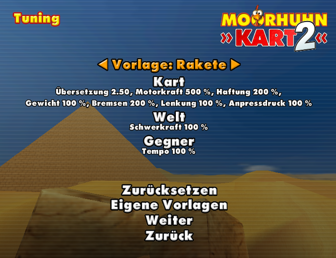
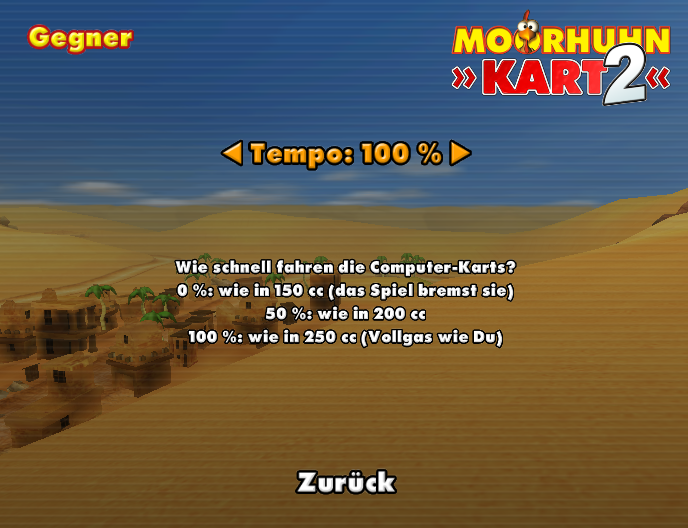
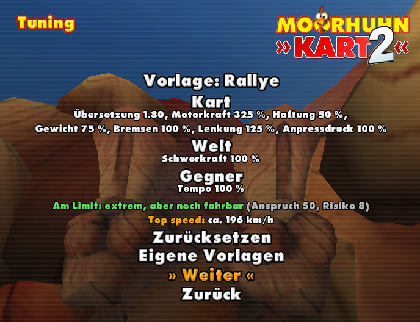

[← Overview](../README.md) · [All documents](README.md)

# Tuning class

*Leistungsklasse wählen → Tuning* opens a page of its own before the character menu. The
class opens with a win of Meisterschaft 2 in 250 cc (see [Unlocking](engine-classes.md#unlocking-200-cc-250-cc-and-tuning)) and then has all
eight tracks and both championships. The page has the row *Vorlage*, then the buttons of the
three groups of values, each with its current values below it, and the buttons
*Zurücksetzen* (puts the defaults back), *Eigene Vorlagen* (your own presets) and *Weiter*.

- **Kart**: the seven kart values (gearing, pull, grip, weight, brakes, steering, downforce).
- **Welt**: the gravity.
- **Gegner**: how fast the computer karts drive (see below).

 

Each row is changed with ← / → or a click on its arrows; *Zurück* or Esc returns to the
tuning page. Below the rows a short text explains the row that is selected.

**Gegner.** The game holds the computer karts back: they drive with part throttle while
they are near you, each with its own random strength, and slow down further when they are
ahead. *Tempo* (−100 to 200 % in steps of 25) sets how much of that stays: 0 % is the game's
handicap (as in 150 cc), 50 % half of it (as in 200 cc), 100 % none (as in 250 cc: full
throttle all the time, like you). Below 0 they get less throttle still, down to none at
−100 %, where they creep along at walking pace (the game gives every kart full throttle below
10 units/s). Above 100 % they keep full throttle and get more engine power than your kart:
at 200 % twice the pull (thrust and grip limit, like *Motorkraft*, on top of it and of
power-ups). That makes them quicker out of corners but not faster on the straights, where
the gearing sets the top speed.
Races on the first track (mean speed of the six computer karts, units/s, 250 cc values):
−100 %: 10.2, −50 %: 38.3, 0 %: 43.6, 50 %: 46.7, 100 %: 49.0 – 49.8, 150 %: 51.1, 200 %: 51.1.
The default is 100 %, like the other defaults the 250 cc kart. *Tempo* is part of the presets
like every other value: the class copies have the pace of their class, an own slot keeps it.

**Am Limit.** With nine values there are far too many combinations to try by hand, and many
extreme ones hardly make a race: the computer karts stand stuck, are reset again and again or
spend the race on their tails. A line on the tuning page and on each of its pages helps to
find the extreme ones that still work. Every value gives **Anspruch** (challenge) and **Risiko**
(risk) points, and the line shows both:

| Line | Meaning |
| --- | --- |
| *Am Limit: extrem, aber noch fahrbar (Anspruch …, Risiko …)* (green) | Anspruch 24 or more, Risiko below 12: the values make the race clearly harder (faster, less grip, less steering or brakes, unusual gravity, quicker opponents), and races with such values went about as well as with the defaults |
| *Hart am Limit: gerade noch fahrbar (…)* (bright green) | Anspruch 24 or more, Risiko 12 – 23: the same, close to where races stop working |
| *Anspruch … (Am Limit ab 24), Risiko …* (grey) | near the defaults, or only easier or slower (the defaults: 0 and 0) |
| *Anspruch …, Risiko …: zu riskant (fahrbar bis 23)* (orange) | Risiko 24 or more: past what works |

The line follows every step of a value, so one can push a value until the line turns from
*Am Limit* to *Hart am Limit* and then *zu riskant*. Points below 0 (values that make the race
easier) are shown as 0. How it is computed: every value gives
challenge points (set by hand) and risk points, plus three products for values that act
together (opponents' tempo and engine power, engine power and weight against downforce,
gearing against downforce). The risk points are a fit to about 1250 races of 45 s with six
computer karts on all eight tracks (60 FPS): how long they stood still, how often they were
reset, and how much of the race they spent with no wheel on the ground, compared with the default
values on the same track. In those races the computer karts did:

| Line | Races | Mean badness | Clearly bad races |
| --- | --- | --- | --- |
| *Am Limit* | 215 | 0.26 | 7 % |
| *Hart am Limit* | 304 | 0.42 | 15 % |
| *zu riskant* | 367 | 1.50 | 62 % |
| the defaults | 18 | 0.01 | 0 % |

(Badness 0 is a race like with the defaults, 1 one where they clearly got stuck, reset or
airborne.) One value alone, the others at their defaults, shows the line at Übersetzung 2.60 –
2.70 (*Am Limit*) and 2.75 – 3.50 (*Hart*), Motorkraft 575 % (*Hart*), Haftung 50 % (*Am
Limit*) and 25 % (*Hart*), Bremsen 25 % (*Am Limit*), Lenkung 50 % (*Hart*), Schwerkraft 300 %
(*Am Limit*) and 25 % (*Hart*), Gegner 175 – 200 % (*Hart*). The new presets were also raced at
200 FPS with *60-FPS-Fahrphysik* on and did as well. Single races scatter a lot from track to
track, so the line tells what works on average; it judges the computer karts, not how the kart
feels to you. Up to 1.8 the class had yellow warnings for three bad combinations instead.

| Preset | Anspruch | Risiko | Line |
| --- | --- | --- | --- |
| Rakete | 24 | 17 | Hart am Limit |
| Formel 1 | 24 | 16 | Hart am Limit |
| Rallye | 50 | 8 | Am Limit |
| Glatteis | 41 | 10 | Am Limit |
| Bremsversagen | 55 | 4 | Am Limit |
| Schwergewicht | 12 | 23 | (grey) |
| Federleicht | 56 | 10 | Am Limit |
| Hetzjagd | 39 | 21 | Hart am Limit |
| Wahnsinn | 145 | 23 | Hart am Limit |
| Mondfahrt | 32 | 15 | Hart am Limit |
| Mondrakete | 44 | 14 | Hart am Limit |
| Jupiter | 21 | 3 | (grey) |

The class copies, Federgewicht and Schnecke have 0 and 0.

**Top speed.** Below the *Am Limit* line every tuning page shows the top speed the values give,
in km/h (*Top speed: ca. 220 km/h* for the defaults; one unit/s of the game is 3.6 km/h). It is
computed for the character chosen last, as they differ in weight and gearing: with the
defaults moorhuhn and lesshuhn 220, moorfrosch 203, pumpkin 211, snowman 218, turtle 193,
hank 214 km/h (their names in the game's `karts.txt`). The formula comes from about 420 runs on
an endless straight (the kart is put back by 39 units whenever it reaches the end of the start
straight of *Ägypten*) with values spread over all rows and all seven characters: half of them
are within 1.8 % of it, nine in ten within 7 %, every preset within 2.5 %. It balances the
engine's pull (torque curve, gearing, *Motorkraft*) against the air and, the bigger part, the
chassis: from about 61 units/s (220 km/h) on, the downforce and the weight press the kart down
harder than its wheels can carry, and the chassis rubs on the road. So *Übersetzung* alone soon
stops adding speed (measured: 2.00 gives 223, 3.00 gives 230 km/h; the line says 226 for both);
more *Motorkraft*, more *Gewicht*, less *Anpressdruck* or less *Schwerkraft* push that wall
further out. *Haftung*, *Bremsen* and *Lenkung* make no difference on a straight. The number is
for 60 FPS physics (the switch on, or the game at 60 FPS) and for flat ground without power-ups;
the siren and the power can go beyond it.

The row *Vorlage* copies a ready-made set of values into all rows: ← / → (or its
arrows) steps through the presets below, and from there each row can be changed further. The
row shows the name of the preset the values match (the one copied last, if two match), or
*Ungespeichert* once they match none; then ← / → continue from the preset copied last.

| Preset | Übers. | Motor | Haft. | Gew. | Brems. | Lenk. | Anpr. | Schwer. | Tempo | Top speed | Idea |
| --- | --- | --- | --- | --- | --- | --- | --- | --- | --- | --- | --- |
| 50 cc | 0.90 | 100 | 100 | 100 | 100 | 100 | 100 | 100 | −25 | 130 | the class |
| 100 cc | 1.10 | 100 | 100 | 100 | 100 | 100 | 100 | 100 | 0 | 156 | the class |
| 150 cc | 1.30 | 100 | 100 | 100 | 100 | 100 | 100 | 100 | 0 | 180 | the class |
| 200 cc | 1.47 | 150 | 100 | 100 | 100 | 100 | 100 | 100 | 50 | 206 | the class (its gearing is 1.468) |
| 250 cc | 1.55 | 200 | 100 | 100 | 100 | 100 | 100 | 100 | 100 | 220 | the class (1.545); the defaults |
| Rakete | 3.45 | 325 | 250 | 100 | 400 | 200 | 250 | 100 | 100 | 325 | much faster, grip, brakes and steering to match |
| Formel 1 | 3.60 | 300 | 200 | 100 | 400 | 200 | 350 | 100 | 100 | 318 | long gearing held down by downforce, big brakes |
| Rallye | 1.80 | 325 | 50 | 75 | 100 | 125 | 100 | 100 | 100 | 196 | strong, light engine on half the grip, quick steering |
| Glatteis | 1.55 | 200 | 50 | 100 | 75 | 125 | 75 | 100 | 100 | 220 | everything slides |
| Bremsversagen | 2.65 | 250 | 100 | 100 | 25 | 100 | 325 | 100 | 100 | 223 | fast, and the brakes are nearly gone: slow down early |
| Schwergewicht | 1.55 | 250 | 100 | 250 | 250 | 100 | 200 | 100 | 100 | 222 | two and a half times the weight |
| Federgewicht | 1.55 | 100 | 100 | 50 | 100 | 100 | 100 | 100 | 100 | 160 | half the weight, half the engine |
| Federleicht | 2.90 | 325 | 175 | 25 | 100 | 100 | 175 | 150 | 100 | 244 | a quarter of the weight on a fast kart, more gravity to keep it down |
| Hetzjagd | 1.75 | 275 | 150 | 100 | 100 | 100 | 100 | 100 | 200 | 226 | a bit faster than 250 cc, and the computer karts are stronger than you |
| Schnecke | 0.50 | 100 | 100 | 100 | 100 | 100 | 100 | 100 | 100 | 74 | top speed 20, for learning a track |
| Wahnsinn | 3.15 | 350 | 50 | 25 | 25 | 100 | 275 | 300 | 100 | 277 | everything extreme at once: long gearing, little grip, a feather, no brakes, three times the gravity |
| Mondfahrt | 1.55 | 200 | 100 | 100 | 100 | 100 | 100 | 25 | 100 | 220 | 250 cc on a quarter of the gravity: long jumps |
| Mondrakete | 3.60 | 325 | 175 | 100 | 100 | 200 | 350 | 50 | 100 | 336 | a very fast kart on half the gravity, held down by downforce |
| Jupiter | 1.55 | 200 | 100 | 100 | 100 | 100 | 100 | 250 | 100 | 188 | 250 cc on Jupiter (2.5 times the gravity) |

The class copies drive like the classes, up to the third decimal of the gearing (the copies of
200 cc and 250 cc are 0.07 and 0.18 units/s faster at the top). Their computer karts follow
the 150 cc rules with *Tempo*, so the copies of 50 cc (−25 %) and 100 cc (0 %) only come
close to the real classes' opponents. The other presets were tried
by the computer karts only. Version 1.9 changed *Rakete*,
*Formel 1*, *Rallye*, *Glatteis*, *Schwergewicht* and *Wahnsinn*: their old values left the
computer karts stuck, reset or on their tails in many races (badness 0.4 to 1.4, see *Am Limit*);
the new ones were searched with the *Am Limit* computation and raced on all eight tracks (14
races each: badness 0.15 to 0.7, as fast or faster). It dropped *Dragster* (no variant with its
idea worked: badness 1.6 to 3) and added *Bremsversagen*, *Federleicht*, *Hetzjagd* and
*Mondrakete*, found the same way (14 races each: badness 0.08 to 0.57).

**Own presets.** *Eigene Vorlagen* on the tuning page opens a page with eight slots for your
own sets of values:

- ← / → on the top row picks the slot (*Platz 1* … *Platz 8*); below it are the slot's values,
  grouped *Kart*, *Welt* and *Gegner*, or *(leer)*. All slots start empty.
- *Speichern* stores all values currently set (kart, gravity and *Tempo*) in the slot (it overwrites
  whatever was there). So: copy a preset with *Vorlage*, change it, open *Eigene Vorlagen*,
  pick a slot, *Speichern*.
- *Laden* copies the slot's values onto the tuning page and goes back there.
- *Umbenennen* opens the game's name page with the slot's name. *Weiter* keeps the typed
  name (up to 15 characters, the letters, digits and `- . !` the name page allows), Esc
  leaves it as it was, and an empty name gives the slot its default name back, *Eigene N*.
- *Löschen* empties the slot, its name included. There is no confirmation.
- The filled slots also come up in the *Vorlage* row of the tuning page, after the built-in
  presets, under their names.
- The slots are kept in `settings.dat`.

**In the pause menu.** While racing, the pause page (Esc) shows what the race runs with: the
class and the *60-FPS-Fahrphysik* switch, in the tuning class also the preset the values match
(the name of an own slot, or *Ungespeichert*) and all nine values, and the top speed of the kart
in the race (see *Top speed* above; in the other classes for the class). The page's own items sit a
little lower to make room.

| Row | What it changes | Range | Default |
| --- | --- | --- | --- |
| Übersetzung | The class factor: longer gearing, higher top speed. 150 cc has 1.30 | 0.50 – 4.00 | 1.55 |
| Motorkraft | Pull: thrust and the limit of what the tyres put on the road | 25 – 1000 % | 200 % |
| Haftung | Grip of the tyres, sideways and in the driving direction | 25 – 400 % | 100 % |
| Gewicht | Mass of the kart | 25 – 400 % | 100 % |
| Bremsen | Brake force | 25 – 400 % | 100 % |
| Lenkung | Largest steering angle | 25 – 200 % | 100 % |
| Anpressdruck | Downforce | 0 – 800 % | 100 % |
| Schwerkraft (page *Welt*) | Gravity of the whole race: karts, computer karts and loose objects. 100 % = the game's 19.62 units/s² | 25 – 300 % | 100 % |
| Tempo (page *Gegner*) | Throttle of the computer karts: −100 % walking pace, 0 % as in 150 cc, 100 % full throttle; above that, more engine power than yours | −100 – 200 % | 100 % |

- The defaults are the 250 cc kart, to the nearest step (its gearing is 1.545). The percent
  rows are relative to the chosen character, so the characters keep their differences
  (Moorhuhn has more grip, Hank brakes harder, …).
- The values are stored in `settings.dat` and apply to **every kart in the race**, computer
  karts included, the same way a class does.
- The class has its own highscore lists and phantom karts (`phantom-6-NN.mhk2`). They mix runs
  with any values, so they are for fun, not for comparing.

What one row does on its own, measured with Moorhuhn from a standing start on a flat straight
at 60 FPS (speed in game units per second, the other rows at their defaults):

| Setting | After 0.5 s | After 1 s | After 2 s | |
| --- | --- | --- | --- | --- |
| Defaults | 16.9 | 31.9 | 49.8 | like 250 cc |
| Übersetzung 0.50 | 15.4 | 19.7 | 20.7 | top speed 20.8 |
| Übersetzung 4.00 | 17.3 | 34.8 | 63.9 | still gaining at the end of the straight |
| Motorkraft 25 % | 2.7 | 5.4 | 11.2 | |
| Motorkraft 1000 % | 22.9 | 37.4 | 62.6 | |
| Haftung 25 % | 5.6 | 11.4 | 25.7 | the wheels spin |
| Haftung 400 % | 18.2 | 25.0 | 46.3 | better off the line, then slower |
| Gewicht 25 % | 24.2 | 33.5 | 32.7 | top speed 34 |
| Gewicht 400 % | 15.2 | 17.8 | 28.5 | 47.7 after 3 s |
| Anpressdruck 0 % | 15.3 | 26.5 | 42.0 | 53.8 after 3 s, still gaining |
| Anpressdruck 800 % | 28.0 | 29.8 | 30.6 | top speed 31 |

- **Weight** changes more than the launch. Thrust, brakes and the resistance at speed are
  forces, so a light kart reacts harder to all three: quick off the line, low top speed.
- **Downforce** presses the kart onto the road with the square of its speed. That gives the
  tyres more to work with and holds the kart back at the same time. Bremsen and Lenkung do
  nothing on a straight; they were checked in the kart's values only.
- **Extreme values are allowed and can all be combined.** The computer karts raced the
  wildest ones for 45 s each on the first track, at 60 and at 200 FPS: everything at its
  maximum, with the weight at 400 %, at 50 % and at 25 %. No kart flew off. With the weight
  at 50 % they average 83 units/s, almost twice their pace with the default values (43);
  at 400 % such a kart is mostly stuck (29). Expect wheelies at the start and karts that
  bounce off walls and each other.
- **Gravity** pulls on every kart and loose object of the race. Races with the computer karts on the first track, 45 s, 60 FPS (mean speed of
  the six karts; the defaults: 43.8):

  | Schwerkraft | 25 % | 50 % | 100 % | 200 % | 250 % (*Jupiter*) | 300 % |
  | --- | --- | --- | --- | --- | --- | --- |
  | 250 cc values | 40.5 | 44.3 | 43.8 | 44.8 | 43.1 | 40.8 |
  | *Wahnsinn* values up to 1.8 | 79.2 | | 82.9 | | | 81.5 |

  No kart flew off at any gravity, also not at 200 FPS with and without the switch. The
  pace hardly changes; how gravity feels by hand (jumps, sliding) nobody has tried yet.
- At high frame rates, switch *60-FPS-Fahrphysik* on for this class. Without it the soft
  springs of high frame rates let the chassis carry most of a strong downforce (the effect
  the switch is there for, only stronger).

**Downforce rules of this class.** The game applies the downforce along the kart's own
"down", growing with the square of the forward speed and also in the air. Far beyond the
stock classes that no longer works: the suspension starts to hammer, and a kart that tumbles
in the air accelerates itself until it is gone. So the tuning class adds three rules:

- The downforce stops growing at the value a kart with stock weight and stock downforce has
  at 120 units/s, which is 3.8 times what a 250 cc kart has at top speed.
- While no wheel touches the ground the limit is the value at 75 units/s.
- A kart that is tilted by more than 60° gets none. On its back it would be pushed into the
  sky; standing on its tail in a wheelie, which ten times the thrust makes it do, it would be
  shoved forward faster than its engine can go.

With the default values the first two do not come into play: the gearing of a 250 cc kart
ends at 65 units/s, with the power can at 74. So the default tuning kart drives like the
250 cc kart; only lying on its side or back it behaves differently.
